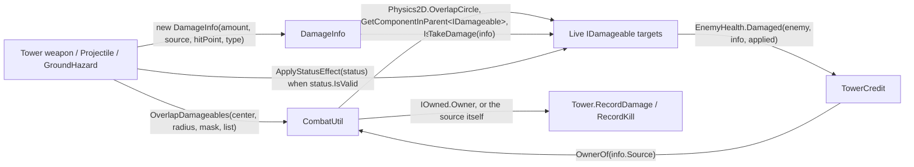

# Technical Documentation: Combat Contracts (IDamageable, DamageInfo, StatusEffectData, CombatUtil)

**Target Unity Version**: Unity 6 (`6000.6.0f1`)  
**Context**: 2D Tower Defense Game  
**File Location**: `Assets/_Game/Features/Combat/Scripts/`  
**Companion Files**: `IDamageable.cs`, `IHealthReadable.cs`, `IOwned.cs`, `DamageInfo.cs` (also holds `DamageType`), `StatusEffectData.cs`, `CombatUtil.cs`

---

## 1. Overview & Architecture

<!-- prose:overview -->
The Combat feature's contracts are the thin layer every weapon, hazard and enemy agrees on. A weapon never knows what an enemy is: it finds things that implement `IDamageable`, hands each one a `DamageInfo` and, when it has one, a `StatusEffectData`. The enemy never knows what a tower is: a hit carries a `Source` GameObject, and `IOwned` lets a loose object such as a projectile say which tower should be credited. `CombatUtil` holds the overlap queries and the splash loop once, so no weapon writes its own. Nothing in these files references `EnemyHealth`, `Tower` or any other concrete class.

### Key Architectural Pillars
- **Interfaces, not base classes**: `IDamageable` and `IHealthReadable` are the only things a weapon needs; enemies implement them today, and the `IDamageable` summary says destructible scenery and the Queen can implement them later without the combat code changing.
- **Plain data for a hit**: `DamageInfo` is a struct so a hit costs no allocation during heavy waves; `StatusEffectData` is a serializable struct so designers set it up on the projectile prefab.
- **Two interfaces for health on purpose**: dealing damage does not require knowing the target's health, so `IHealthReadable` is separate and towers that target Strongest or Weakest fall back to distance when a target does not implement it.
- **The `IsAlive` cast matters**: Unity's `==` overload on `UnityEngine.Object` does not apply through an interface reference, so `target != null` on an `IDamageable` lets a destroyed enemy through. `CombatUtil.IsAlive` casts back to `Object` to restore the real check.
- **Credit without coupling**: `IOwned` and `CombatUtil.OwnerOf` resolve a hit's `Source` to the tower that fired it, so the enemy layer and the credit code stay apart.
- **No allocation in queries**: `CombatUtil` reuses static buffers, resets them on `SubsystemRegistration`, and fills caller-owned lists instead of returning new ones.
<!-- /prose -->

---

## 2. Data flow

<!-- prose:structure -->

Splash follows the same path with one extra rule: `ApplySplash` damages everything in a circle and skips the `ignore` target, so a direct hit is not also counted as splash on the same enemy.
<!-- /prose -->

---

## 3. Types Reference

<!-- generated:fields -->
### `IDamageable` (interface)
Anything a tower, projectile or hazard can hurt.

| Member | Type | Description |
| :--- | :--- | :--- |
| `TakeDamage(DamageInfo info)` | `void` | Apply one hit. Implementations decide how type and resistances interact. |
| `ApplyStatusEffect(StatusEffectData status)` | `void` | Apply a damage-over-time or slow. Re-applying the same effect refreshes it. |
| `IsDead` | `bool` (get) | True once health has run out. Targeting skips these. |
| `Transform` | `Transform` (get) | Where this target is, for aiming and distance checks. |

### `IHealthReadable` (interface)
An `IDamageable` that will also tell you how much health it has left. Kept separate because plenty of damageable things (scenery, shields) have no meaningful "strongest" reading.

| Member | Type | Description |
| :--- | :--- | :--- |
| `CurrentHealth` | `float` (get) | Health remaining right now. |
| `MaxHealth` | `float` (get) | Health when at full. |

### `IOwned` (interface)
Something that acts on behalf of another object: a shot or a hazard left by a tower. Damage it deals is credited to `Owner`, not to the loose object itself.

| Member | Type | Description |
| :--- | :--- | :--- |
| `Owner` | `GameObject` (get) | The object to credit, or null when none was set. |

### `DamageType` (enum, in `DamageInfo.cs`)
How a hit should be treated. Resistances key off this. Values: `Physical`, `Magic`, `True`, `Fire`, `Poison`, `Lightning`.

### `DamageInfo` (struct)
One instance of damage travelling from a source to a target. A struct so hits cost no allocation during heavy waves.

| Member | Type | Description |
| :--- | :--- | :--- |
| `Amount` | `float` | Raw damage before the target's own resistances. |
| `Source` | `GameObject` | What caused the hit. May be null if the source was already recycled. |
| `HitPoint` | `Vector2` | Where the hit landed, for impact effects and knockback direction. |
| `Type` | `DamageType` | Which resistance applies. |
| `IsCritical` | `bool` | True for a critical hit. Purely cosmetic for now: damage popups show it as a crit. |
| `DamageInfo(float amount, GameObject source, Vector2 hitPoint, DamageType type = DamageType.Physical)` | constructor | Sets the four fields and leaves `IsCritical` false. |

### `StatusEffectData` (struct, `[Serializable]`)
A damage-over-time and/or slow that a hit can leave behind. Serializable so designers set it up on the projectile prefab.

| Member | Type | Description |
| :--- | :--- | :--- |
| `EffectName` | `string` | Identifies the effect. Re-applying the same name refreshes it instead of stacking. |
| `DamagePerTick` | `float` | Damage dealt each tick. Zero for a pure slow. `[Min(0)]`. |
| `TickInterval` | `float` | Seconds between ticks. Values at or below zero are treated as one tick per second. `[Min(0)]`. |
| `Duration` | `float` | Total seconds the effect lasts. Zero or less means this effect does nothing. `[Min(0)]`. |
| `SlowMultiplier` | `float` | Movement speed multiplier while active. 1 = no slow, 0.5 = half speed. `[Range(0, 1)]`. |
| `IsValid` | `bool` (get) | True if this effect would actually do something: `Duration > 0` and (`DamagePerTick > 0` or `SlowMultiplier < 1`). |
| `SafeTickInterval` | `float` (get) | Tick interval clamped to something safe to divide by: `TickInterval` when above 0.01, otherwise 1. |
| `None` | `StatusEffectData` (static get) | A no-op effect with `SlowMultiplier` 1. Use for "this weapon applies nothing". |
<!-- /generated -->

---

## 4. Public API Reference

<!-- generated:api -->
All members below are `public static` on `CombatUtil`. The class also keeps a private `Collider2D` overlap buffer, a private splash buffer, a `ContactFilter2D` that includes triggers, and a `[RuntimeInitializeOnLoadMethod(SubsystemRegistration)]` reset that clears the buffers.

#### `void OverlapDamageables(Vector2 center, float radius, LayerMask mask, List<IDamageable> results)`
Fills `results` with live damageables whose collider overlaps the circle. Clears the list first, returns at once for a radius of zero or less, and adds each target once even when it has several colliders.

#### `IDamageable NearestDamageable(Vector2 from, float radius, LayerMask mask, List<IDamageable> buffer)`
The live damageable nearest to a point within a radius, or null. Runs `OverlapDamageables` into `buffer` and compares squared distances from each target's `Transform`.

#### `bool IsAlive(IDamageable target)`
True if a target still exists and has health left: the target is a `UnityEngine.Object` that is not destroyed, `IsDead` is false and `Transform` is not null. Use this rather than a plain null check anywhere an `IDamageable` is held across frames. The remark in code explains why the cast is the whole point: Unity overloads `==` on `UnityEngine.Object` so a destroyed component reports as null, but that overload does not apply through an interface reference, so `target != null` on an `IDamageable` is an ordinary reference comparison, a destroyed enemy sails through it, and the next member access throws `MissingReferenceException`.

#### `bool TryGetDamageable(Collider2D collider, out IDamageable damageable)`
Finds the live `IDamageable` owning a collider, if any. Uses `GetComponentInParent` because colliders often sit on a child of the object holding the health component, then returns `IsAlive` on the result.

#### `void ApplySplash(Vector2 center, float radius, LayerMask mask, float damage, DamageType type, GameObject source, StatusEffectData status, IDamageable ignore = null)`
Damages everything in a circle with `new DamageInfo(damage, source, center, type)` and applies `status` to each target when `status.IsValid`. `ignore` is skipped so a direct hit is not also counted as splash. Returns at once when radius or damage is zero or less.

#### `GameObject OwnerOf(GameObject source)`
Who should be credited for damage from `source`: the `IOwned.Owner` when the source has an `IOwned` component with a non-null owner, otherwise the source itself (a tower's own beam, aura or field is its own owner). Null in, null out.

#### `float SqrDistance(Transform a, Transform b)`
Squared distance between two transforms in 2D, for cheap comparisons. Positive infinity when either transform is null.
<!-- /generated -->

---

## 5. Rules worth knowing

<!-- prose:lifecycle -->
- **Splash and direct hit**: a projectile applies its direct hit itself, then calls `ApplySplash` with that target as `ignore`. Without it the same enemy would take the direct amount and the splash amount from one shot.
- **Nested splash**: a hit's own reaction could splash again from inside `TakeDamage`. The outer call walks the shared splash buffer; a nested call gets a fresh list of its own so the list being walked is not cleared under it. The shared buffer is cleared in a `finally`.
- **Status effects go through `IsValid`**: every weapon checks `_status.IsValid` before calling `ApplyStatusEffect`, and `EnemyHealth.ApplyStatusEffect` ignores an invalid effect anyway. A default-constructed `StatusEffectData` has `SlowMultiplier` 0, which would be a full stop if its `Duration` were ever set; use `StatusEffectData.None` for "applies nothing".
- **Owner lookup through `IOwned`**: `Tower` sets `shot.Owner = gameObject` when it fires, `Projectile` copies its `Owner` onto the `GroundHazard` it leaves, and `ClusterProjectile` copies it onto each fragment. `TowerCredit` then calls `OwnerOf(info.Source)` and `GetComponentInParent<Tower>()` on the result. A weapon that is a child of its tower needs no `IOwned`; `OwnerOf` returns the source and the parent lookup finds the tower.
- **The shared buffers and your list**: `OverlapDamageables` clears the `results` list you pass on every call and the internal `Collider2D` buffer is static and reused, so keep one `List<IDamageable>` per component (as `Tower._inRange`, `Projectile._overlapBuffer`, `GroundHazard._inside` and `ChainLightning._candidates` do) and copy out anything you need to keep before the next query. Never hand the same list to two overlapping queries, and never hold an `IDamageable` across frames without re-checking `IsAlive`.
- **Masks**: the filter uses the mask you pass and includes triggers. Every caller in the project defaults its mask to `~0` (everything), so a target on any layer is found unless the prefab narrows it.
<!-- /prose -->

---

## 6. Who uses these

<!-- prose:integration -->
From a grep over `Assets/_Game` on 2026-10-14.

| Contract or helper | Implemented by | Called by |
| :--- | :--- | :--- |
| `IDamageable` | `EnemyHealth` | `Tower` (targeting list, `CurrentTarget`, `AcquireTarget`, `FireAt`), `TowerWeapon.Shoot` / `Track`, `Projectile`, `RicochetProjectile`, `ClusterProjectile`, `ChainLightning`, `ContinuousBeam`, `GroundHazard`, `OrbitingDamageField`, `ProximityMine`, `PulseTower`, `FrostAuraTower`, `KnockbackTower`, `EnemyHealer` |
| `IHealthReadable` | `EnemyHealth` | `Tower.ScoreFor` for Strongest and Weakest targeting |
| `IOwned` | `Projectile`, `GroundHazard` | `CombatUtil.OwnerOf` |
| `DamageType` | (enum) | Serialized on `Projectile`, `ContinuousBeam`, `GroundHazard`, `OrbitingDamageField`; fixed in `ChainLightning` (Lightning), `FrostAuraTower` (Magic), `KnockbackTower` (Physical), `ProximityMine` (Fire), `EnemyHealth` DoT ticks (Poison) |
| `DamageInfo` | (struct) | Built by every weapon above; consumed by `EnemyHealth.TakeDamage`, `IIncomingDamageModifier`, `TowerCredit`, `CombatPlayModeTests` |
| `StatusEffectData` | (struct) | Serialized on `Projectile`, `ChainLightning`, `ContinuousBeam`, `GroundHazard`, `OrbitingDamageField`, `FrostAuraTower`; consumed by `EnemyHealth.ApplyStatusEffect`, `CombatPlayModeTests` |
| `CombatUtil.OverlapDamageables` | `CombatUtil` | `Tower`, `Projectile`, `RicochetProjectile`, `ChainLightning`, `GroundHazard`, `OrbitingDamageField`, `ProximityMine`, `PulseTower`, `EnemyHealer` |
| `CombatUtil.NearestDamageable` | `CombatUtil` | `Projectile` (homing retarget) |
| `CombatUtil.IsAlive` | `CombatUtil` | `ChainLightning`, `ContinuousBeam`, `Projectile` |
| `CombatUtil.TryGetDamageable` | `CombatUtil` | Only `CombatUtil.OverlapDamageables` itself |
| `CombatUtil.ApplySplash` | `CombatUtil` | `Projectile`, `RicochetProjectile` |
| `CombatUtil.OwnerOf` | `CombatUtil` | `TowerCredit` |
| `CombatUtil.SqrDistance` | `CombatUtil` | `Tower.ScoreFor` |
<!-- /prose -->

---

## 7. Setup guide

<!-- prose:setup -->
### Making something damageable
1. Write a `MonoBehaviour` that implements `IDamageable`: `TakeDamage(DamageInfo)`, `ApplyStatusEffect(StatusEffectData)`, `IsDead` and `Transform`. Return `transform` for `Transform`, and have `TakeDamage` ignore hits once `IsDead` is true, since `OverlapDamageables` already skips dead targets but a weapon may still hold a reference from an earlier query.
2. If towers should be able to pick it as Strongest or Weakest, also implement `IHealthReadable` (`CurrentHealth`, `MaxHealth`). Otherwise those targeting modes fall back to distance for it.
3. Add a `Collider2D` to the object or a child of it. `TryGetDamageable` looks up through `GetComponentInParent`, so the collider may sit on a child; triggers count because the filter sets `useTriggers`.
4. Put the object on a layer the weapons' `_targetMask` fields include. The project's weapons default to everything, so a new layer only needs attention if a prefab has narrowed its mask.
5. Press Play and check: a tower in range should list the object in `_inRange` and call `TakeDamage`. If the object is destroyed mid-fight, anything still pointing at it must go through `CombatUtil.IsAlive`, not a null check.
<!-- /prose -->
