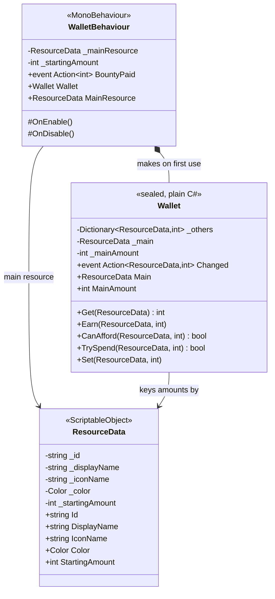

# Technical Documentation: Economy (ResourceData, Wallet, WalletBehaviour)

**Target Unity Version**: Unity 6 (`6000.6.0f1`)  
**Context**: 2D Tower Defense Game  
**File Location**: `Assets/_Game/Features/Economy/Scripts/`  
**Companion Files**: `ResourceData.cs`, `Wallet.cs`, `WalletBehaviour.cs`; tests in `Assets/_Game/Tests/EditMode/WalletTests.cs`

---

## 1. Overview & Architecture

<!-- prose:overview -->
The Economy feature counts what the player holds during one run and nothing else. `ResourceData` is an asset that names one resource, such as Food. `Wallet` is a plain C# class that holds a main resource and any number of others, earns, spends and reports changes. `WalletBehaviour` puts one `Wallet` in a scene and pays enemy bounties into it. Prices are not set here: a tower's build cost lives on its `TowerData`, upgrade costs on `TowerPlacer`, and `TowerCommands` does the paying. The `ResourceData` remarks say Honeydew, which is kept between runs, lives in the save file and is not a `ResourceData`, so nothing in this folder persists between runs.

### Key Architectural Pillars
- **Rules off the scene**: `Wallet` has no `UnityEngine.Object` and only `System` usings, so every rule is covered by EditMode tests without a scene.
- **A null resource means the main one**: every `Wallet` method takes a `ResourceData`; null, or the asset that is currently `Main`, both address the main amount. Callers that only deal in Food pass null.
- **Never below zero**: `Set` clamps at zero, and `TrySpend` refuses a spend larger than what is held and changes nothing.
- **One change event**: `Wallet.Changed` fires on every real change with the resource and its new amount, and never for a no-op or a failed spend, so a HUD needs only that one hook.
- **Bounties by event, not by call**: `WalletBehaviour` listens to the static `EnemyHealth.Defeated`; the enemy never knows a wallet exists.
- **Thin component**: `WalletBehaviour` holds two fields and the bounty handler. Spending through the component means going through its `Wallet` property.
<!-- /prose -->

---

## 2. Data Structures

<!-- prose:structure -->

The main amount is kept in its own field, not in the dictionary. Every other resource is stored only once it has been earned, spent or set; until then `Get` returns its `StartingAmount`.
<!-- /prose -->

---

## 3. Inspector Fields Reference

<!-- generated:fields -->
### ResourceData
Created from **Assets > Create > Hold the Hill > Economy > Resource Data** (default file name `ResourceData`). No `[Header]` in code.

| Field | Type | Default | Description |
| :--- | :--- | :--- | :--- |
| `_id` | `string` | empty | Short id used in code and saves, e.g. Food. |
| `_displayName` | `string` | empty | Name shown to the player. |
| `_iconName` | `string` | empty | Icon name, for whatever draws it. |
| `_color` | `Color` | `Color.white` | Colour for its numbers and pickups. |
| `_startingAmount` | `int` | `0` | How much a run starts with. `[Min(0)]`. |

### WalletBehaviour: Starting Economy
Added from **Add Component > Hold the Hill > Economy > Wallet**.

| Field | Type | Default | Description |
| :--- | :--- | :--- | :--- |
| `_mainResource` | `ResourceData` | `null` | The main resource: what bounties pay and towers cost by default. Its starting amount is used when set. |
| `_startingAmount` | `int` | `500` | Starting amount when no main resource is assigned. `[Min(0)]`. Carries `[FormerlySerializedAs("_startingFood")]` and `[FormerlySerializedAs("_startingGold")]`, so scenes saved under either older name keep their value. |

`Wallet` is not serialized and has no Inspector fields.
<!-- /generated -->

---

## 4. Public API Reference

<!-- generated:api -->
### Properties
| Property | Type | Description |
| :--- | :--- | :--- |
| `ResourceData.Id`, `DisplayName`, `IconName`, `Color`, `StartingAmount` | `string`, `string`, `string`, `Color`, `int` | Read-only views of the five serialized fields. No `/// 
` in code. |
| `Wallet.Main` | `ResourceData` (get, set) | The main resource, or null when there is none. Changing it keeps the main amount: the scene decides what the main resource is, the wallet only counts it. |
| `Wallet.MainAmount` | `int` | How much of the main resource is held. |
| `WalletBehaviour.Wallet` | `Wallet` | The wallet. Made on first use, so it is there before Awake for anything that asks early; follows the main resource if that is assigned later (a builder, a test). |
| `WalletBehaviour.MainResource` | `ResourceData` | The main resource, or null when none is assigned. |

### C# Events
| Event | Signature | Raised when |
| :--- | :--- | :--- |
| `Wallet.Changed` | `Action<ResourceData, int>` | The amount of any resource changes, with the resource (the main one, possibly null) and its new amount. Raised by every `Set`, and so by every `Earn` and successful `TrySpend` that moves an amount. |
| `WalletBehaviour.BountyPaid` | `Action<int>` | A bounty is paid, with the amount after multipliers. Not raised for refunds or cheats. |

### Public Methods

#### `Wallet(ResourceData main, int startingMain)`
A wallet whose main resource starts at `startingMain`, clamped to zero or more. `main` may be null.

#### `int Get(ResourceData resource)`
How much of a resource is held. For null or `Main`, the main amount; for another resource, its stored amount, or its `StartingAmount` if it has never changed.

#### `void Earn(ResourceData resource, int amount)`
Adds to a resource. Nothing happens for zero or less, and no `Changed` is raised.

#### `bool CanAfford(ResourceData resource, int amount)`
True if at least `amount` of the resource is held.

#### `bool TrySpend(ResourceData resource, int amount)`
Takes from a resource if enough is held. Zero or less always succeeds and changes nothing. A spend larger than what is held returns false, changes nothing and raises nothing.

#### `void Set(ResourceData resource, int amount)`
Puts a resource at an exact amount, never below zero. For run start, restarts and cheats. Raises `Changed` with `Main` (possibly null) for the main resource, otherwise with the resource passed. It raises even when the new amount equals the old one.

#### `protected virtual void OnEnable()` and `protected virtual void OnDisable()` (WalletBehaviour)
Subscribe to and unsubscribe from `EnemyHealth.Defeated`. Virtual so a subclass can add its own hooks; an override must call the base or bounties stop.
<!-- /generated -->

---

## 5. Lifecycle & Execution Flow

<!-- prose:lifecycle -->
- **Creation**: `WalletBehaviour` has no `Awake`. The `Wallet` is built the first time anything reads the `Wallet` property, with the main resource's `StartingAmount` if `_mainResource` is set, otherwise `_startingAmount`. A placer or HUD that wakes first still gets a ready wallet.
- **Main resource assigned late**: each read of `Wallet` compares `Wallet.Main` with `_mainResource` and updates `Main` if they differ. The amount is kept, not reset to the new resource's starting amount.
- **OnEnable / OnDisable**: hook and unhook `EnemyHealth.Defeated`. A disabled wallet pays no bounties but can still be spent from.
- **Bounty**: on `Defeated`, the handler ignores a null enemy or one without `EnemyHealth`, computes `Mathf.RoundToInt(BountyValue * UpgradeModifiers.Current.BountyMultiplier)`, and returns if that is zero or less. Otherwise it calls `Wallet.Earn(null, bounty)`, which raises `Changed`, then raises `BountyPaid`. Bounties are always paid in the main resource.
- **No bounty on a breach**: `EnemyHealth.Despawn` raises neither `Died` nor `Defeated`, so an enemy that walks into the hill pays nothing.
- **Static event reset**: `EnemyHealth` clears `Defeated` in a `SubsystemRegistration` reset. `WalletBehaviour` re-subscribes in `OnEnable`, which runs after that reset when Play starts.
- **Two wallets**: every enabled `WalletBehaviour` hears every `Defeated`, so two in one scene would each be paid. Nothing in code prevents it.
<!-- /prose -->

---

## 6. Integration With Other Systems

<!-- prose:integration -->
### With `EnemyHealth.cs` (payer)
`EnemyHealth` has `_bountyValue` (default 10, `[Min(0)]`, under its `Health` header, no tooltip), exposed as `BountyValue` with the summary "Food awarded upon defeat" and a public setter. Death raises the instance `Died` and then the static `Defeated(gameObject)`. The wallet reads `BountyValue` from the dead enemy's own `EnemyHealth`.

### With `TowerCommands.cs` and `TowerPlacer.cs` (spenders)
`TowerPlacer` has a `_wallet` field (`WalletBehaviour`, under `Scene`, tooltip "Pays for towers. Empty means everything is free.") and a `protected virtual Wallet WalletNow` a subclass may replace. It builds `TowerCommands` with `() => WalletNow`, so the wallet is asked for on every command. All costs are `Mathf.RoundToInt(base * UpgradeModifiers.Current.CostMultiplier)`.

| Command | Wallet call | Resource |
| :--- | :--- | :--- |
| `CanAfford(data)` | `CanAfford(data.CostResource, CostOf(data))`; true with no wallet | The tower's `TowerData.CostResource`, null meaning main |
| `TryBuild(data, position)` | `TrySpend(data.CostResource, cost)`; on success places and sets `TotalFoodInvested = cost` | Same |
| `Place(data, position, cost)` | None: places without charging | None |
| `TryUpgrade(tower)` | `TrySpend(null, UpgradeCost(tower))` from `_upgradeCosts` (default `{ 150, 300 }`) by level | Main |
| `Sell(tower)` | `Earn(null, tower.RefundValue)` | Main |

`TowerCommandsTests` covers paying for a build, paying by level for upgrades, a zero upgrade cost at the top level, and that everything is free without a wallet.

### With `UpgradeModifiers.cs`
The wallet reads `BountyMultiplier`; the commands read `CostMultiplier` and, through `Tower.RefundValue`, `RefundPercentage`. With no skill tree registered, `UpgradeModifiers.Current` returns a neutral set whose `BountyMultiplier` is 1.

### Graybox users (sandbox, not the subject)
- `GrayboxEconomy` subclasses `WalletBehaviour` and adds Food shorthands (`CurrentFood`, `EarnFood`, `TrySpendFood`, `ResetFood(500)`) that forward to `Wallet`.
- `GrayboxPickup` is collected by the mouse or by `Collect()` and runs each `GrayboxPickupEffect` on it. `GrayboxResourceGain` is the effect that earns `_amount` (default 5) of `_resource` (empty means main) through `GrayboxEconomy`.
- The dev console's resource commands, the replay tools and `GrayboxGameFlow` find the `GrayboxEconomy` with `FindAnyObjectByType`.
<!-- /prose -->

---

## 7. Setup & Integration Guide

<!-- prose:setup -->
### Step 1: Make or pick the resource asset
1. Grep result on this branch: no `ResourceData` asset exists under `Assets/_Game`. The only one is `Assets/_Sandbox/nilly-ctrl/Graybox/Data/Economy/Food.asset` (Id `Food`, display name `Food`, no icon name, colour `(1, 0.85, 0.3)`, starting amount 500). Its script reference is `ResourceData`; the stale class identifier inside it still reads `GrayboxResourceData`.
2. For a level outside the sandbox, create one with **Assets > Create > Hold the Hill > Economy > Resource Data**. `Assets/_Game/Features/Economy/` holds only `Scripts/` and a `.gitkeep`; there is no `Data/` folder yet.
3. Fill in **Id**, **Display Name**, **Color** and **Starting Amount**.

### Step 2: Put the wallet in the scene
1. On a systems object, **Add Component > Hold the Hill > Economy > Wallet**.
2. Assign the resource from Step 1 as **Main Resource**. Its starting amount wins; **Starting Amount** on the component is only used when **Main Resource** is empty. The graybox `GrayboxSystems.prefab` assigns `Food.asset` here.
3. Keep exactly one enabled wallet per scene, or bounties are paid twice.

### Step 3: Connect the spenders and the display
1. On the `TowerPlacer`, drag the wallet into **Wallet**. Left empty, building and upgrading are free.
2. On each `TowerData`, leave **Cost Resource** empty to pay in the main resource, or assign another `ResourceData`.
3. A HUD reads `wallet.Wallet.MainAmount` once and subscribes to `wallet.Wallet.Changed`; a bounty popup subscribes to `BountyPaid`.

### Step 4: Check in Play Mode
Kill an enemy whose **Bounty Value** is above zero. The main amount should rise by that value, `BountyPaid` should fire once, and an enemy that reaches the hill should pay nothing.
<!-- /prose -->

---

## 8. Against the Indev version

<!-- prose:changes -->
Indev has no counterpart: its `_Game/Features/Economy/` holds only a `.gitkeep`, and no wallet, resource or bounty script exists anywhere under `_Game`. Its `TowerShopManager` only builds one `TowerCardUI` per `TowerData`, which shows `honeydewCost`; the card's click logs "Placement logic pending indev merge." and spends nothing. To spend, the card's click would call `TowerPlacer.CanAfford` and a build through `TowerCommands.TryBuild`, or at the lowest level `walletBehaviour.Wallet.TrySpend(null, cost)`, with the cost read from the fork's `TowerData.BaseCost`, whose `_baseCost` field carries `[FormerlySerializedAs("honeydewCost")]` and whose script keeps the Indev GUID (`7d7d87ff...`), so Indev tower assets keep their price. Indev's name is a mismatch to settle with the team: `ResourceData` says Honeydew is the between-runs currency kept in the save file, while the in-run price is paid in Food.
<!-- /prose -->
