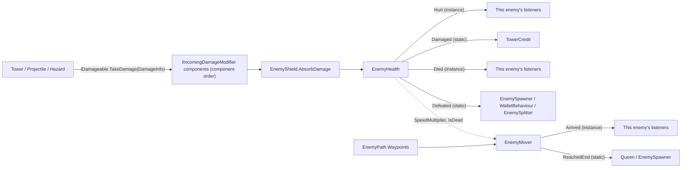

# Technical Documentation: Enemy Scripts (EnemyHealth, EnemyMover and companions)

**Target Unity Version**: Unity 6 (`6000.6.0f1`)  
**Context**: 2D Tower Defense Game  
**File Location**: `Assets/_Game/Features/Enemies/Scripts/`  
**Companion Files**: `EnemyShield.cs`, `EnemyHealer.cs`, `EnemySplitter.cs`, `IIncomingDamageModifier.cs`, `Basic Enemy/EnemyPath.cs`, and from `Features/Combat/Scripts/`: `IDamageable.cs`, `IHealthReadable.cs`, `DamageInfo.cs`, `StatusEffectData.cs`

---

## 1. Overview & Architecture

<!-- prose:overview -->
The fork's enemy is not one class but a small set of components on one GameObject. `EnemyHealth` owns health, status effects, bounty and death; `EnemyMover` owns walking along an `EnemyPath`; `EnemyShield`, `EnemyHealer` and `EnemySplitter` are optional extras that sit beside them. Towers, projectiles and hazards never reference an enemy class directly: they hit anything that implements `IDamageable` (from the Combat feature), and every other system learns what happened through C# events. Nothing in this folder knows what a tower, a wallet or the Queen is.

### Key Architectural Pillars
- **One job per component**: `EnemyHealth` takes damage and dies, `EnemyMover` walks, and neither reads the other's private state; the mover only reads `EnemyHealth.SpeedMultiplier` and `IsDead`.
- **Contracts over classes**: damage arrives through `IDamageable.TakeDamage(DamageInfo)`, and `IHealthReadable` lets towers target Strongest or Weakest without knowing the concrete type.
- **Instance plus static events**: each important moment is raised twice, once on the instance (`Hurt`, `Died`, `Arrived`) and once as a static "any enemy" event (`Damaged`, `Healed`, `StatusApplied`, `Defeated`, `ReachedEnd`) that other assemblies subscribe to without a reference.
- **Interceptable damage**: components implementing `IIncomingDamageModifier` and an `EnemyShield` get to reduce or cancel a hit before health is touched.
- **Pool ready**: both main components reset in `OnEnable`, and `EnemyHealth` can deactivate instead of destroy on death.
<!-- /prose -->

---

## 2. Data flow

<!-- prose:structure -->

Status effects follow the same entry point: `IDamageable.ApplyStatusEffect(StatusEffectData)` starts a coroutine on `EnemyHealth` that lowers `SpeedMultiplier` and, when `DamagePerTick` is above zero, feeds each tick back through `TakeDamage` as `DamageType.Poison` with the enemy itself as `Source`.
<!-- /prose -->

---

## 3. Inspector Fields Reference

<!-- generated:fields -->
### EnemyHealth: Health
| Field | Type | Default | Description |
| :--- | :--- | :--- | :--- |
| `_maxHealth` | `float` | `30` | Health when at full. `[Min(1)]`. |
| `_bountyValue` | `int` | `10` | Food awarded upon defeat. `[Min(0)]`. |
| `_breachDamage` | `float` | `0` | Hill health lost when this enemy walks in. 0 means it was never set; the enemy prefab test catches that. `[Min(0)]`. |

### EnemyHealth: Death
| Field | Type | Default | Description |
| :--- | :--- | :--- | :--- |
| `_despawnDelay` | `float` | `0` | Seconds to wait before the body disappears, leaving room for a death animation. `[Min(0)]`. |
| `_deactivateInsteadOfDestroy` | `bool` | `false` | If on, the enemy is deactivated instead of destroyed, ready for pooling. |

### EnemyMover
| Field | Type | Default | Description |
| :--- | :--- | :--- | :--- |
| `_path` | `EnemyPath` | `null` | Route to walk. Found automatically if left empty (`FindAnyObjectByType<EnemyPath>()` in `Awake`). |
| `_speed` | `float` | `1.5` | Base movement speed in world units per second, before any slows. `[Min(0.01)]`. |
| `_arriveDistance` | `float` | `0.05` | How close counts as reaching a waypoint. `[Min(0.01)]`. |
| `_faceTravelDirection` | `bool` | `false` | If on, the enemy turns to face the direction it is walking. |
| `_onReachEnd` | `EndBehaviour` | `Despawn` | What happens on reaching the last waypoint: `Despawn` (disappears, as if it reached the Queen), `Stop` (stays where it is) or `Loop` (starts again from the first waypoint). |

### EnemyShield: Shield Parameters
| Field | Type | Default | Description |
| :--- | :--- | :--- | :--- |
| `_maxShield` | `float` | `100` | Shield points at full. `[Min(1)]`. No tooltip in code. |
| `_regenRate` | `float` | `10` | Shield points regained per second once regeneration starts. `[Min(0)]`. No tooltip in code. |
| `_regenDelay` | `float` | `4` | Seconds after the last absorbed hit before regeneration starts. `[Min(0)]`. No tooltip in code. |

### EnemyHealer: Healer Parameters
| Field | Type | Default | Description |
| :--- | :--- | :--- | :--- |
| `_healRadius` | `float` | `2.5` | Radius of the heal pulse in world units. `[Min(0.5)]`. No tooltip in code. |
| `_healInterval` | `float` | `1.5` | Seconds between pulses. `[Min(0.2)]`. No tooltip in code. |
| `_healAmount` | `float` | `18` | Health restored to each damaged enemy per pulse. `[Min(1)]`. No tooltip in code. |
| `_targetMask` | `LayerMask` | `~0` (everything) | Layers searched for `IDamageable` targets. No tooltip in code. |

### EnemySplitter: Split Parameters
| Field | Type | Default | Description |
| :--- | :--- | :--- | :--- |
| `_miniAntPrefab` | `GameObject` | `null` | Prefab spawned for each half. Nothing happens while it is empty. No tooltip in code. |
| `_splitCount` | `int` | `2` | How many halves spawn on death. `[Min(1)]`. No tooltip in code. |
| `_spawnOffsetRadius` | `float` | `0.25` | Random offset radius around the death position for each half. `[Min(0)]`. No tooltip in code. |

### EnemyPath
| Field | Type | Default | Description |
| :--- | :--- | :--- | :--- |
| `_roadWidth` | `float` | `1` | Width of the road in world units. Towers can't be placed on it. |
| `_roadColor` | `Color` | `(0.55, 0.42, 0.3)` | Colour of the road sprites laid down in `Awake`. No tooltip in code. |
<!-- /generated -->

---

## 4. Public API Reference

<!-- generated:api -->
### Properties
| Property | Type | Description |
| :--- | :--- | :--- |
| `EnemyHealth.CurrentHealth` | `float` | Health remaining right now (also `IHealthReadable`). |
| `EnemyHealth.MaxHealth` | `float` | Health when at full (also `IHealthReadable`). |
| `EnemyHealth.BountyValue` | `int` (get, set) | Food awarded upon defeat. The one settable value on the component. |
| `EnemyHealth.BreachDamage` | `float` | Hill health lost when this enemy reaches the end of the path. |
| `EnemyHealth.IsDead` | `bool` | True once health has run out (also `IDamageable`). |
| `EnemyHealth.Transform` | `Transform` | This enemy's transform, for aiming and distance checks (also `IDamageable`). |
| `EnemyHealth.SpeedMultiplier` | `float` | Movement speed multiplier from active slows, 1 when unslowed. Slows do not stack; the strongest active one wins. |
| `EnemyHealth.HealthFraction` | `float` | Fraction of health remaining, 0 to 1, for health bars. |
| `EnemyMover.DistanceTravelled` | `float` | Distance walked along the route so far, in world units. |
| `EnemyMover.HasFinished` | `bool` | True once the enemy has run out of path. |
| `EnemyMover.Speed` | `float` | Base speed before slows and `SpeedScale`. |
| `EnemyMover.SpeedScale` | `float` (get, set) | Extra multiplier owned by the enemy's own behaviour (charge, roll, digging). 1 is normal, 0 stops it. Reset to 1 in `OnEnable`. |
| `EnemyMover.IgnoresKnockback` | `bool` (get, set) | If on, `Knockback` does nothing. Reset to false in `OnEnable`. |
| `EnemyMover.DespawnsAtEnd` | `bool` | True when `_onReachEnd` is `Despawn`. The Queen and the spawner check this before treating an arrival as a breach. |
| `EnemyShield.CurrentShield`, `MaxShield`, `ShieldFraction` | `float` | Shield points now, at full, and as a 0 to 1 fraction. |
| `EnemyHealer.HealRadius` | `float` | The configured pulse radius. |
| `EnemyPath.Waypoints` | `IReadOnlyList<Vector3>` | Waypoint positions in world space, in walking order. Filled from child transforms in `Awake`. |
| `EnemyPath.Length` | `float` | Length of the whole route in world units. |

### C# Events
| Event | Signature | Raised when |
| :--- | :--- | :--- |
| `EnemyHealth.Defeated` (static) | `Action<GameObject>` | Any enemy dies, right after that enemy's `Died`. |
| `EnemyHealth.Damaged` (static) | `Action<EnemyHealth, DamageInfo, float>` | Any enemy takes a hit, with the hit after shields and the health actually removed. DoT ticks arrive with the enemy itself as `Source`. |
| `EnemyHealth.Healed` (static) | `Action<EnemyHealth, float>` | Any enemy is healed, with the health actually restored. Not raised when already at full. |
| `EnemyHealth.StatusApplied` (static) | `Action<EnemyHealth, StatusEffectData>` | A status effect starts or restarts on any enemy. For visuals. |
| `EnemyHealth.Hurt` | `Action<DamageInfo, float>` | This enemy takes a hit, just before `Damaged`. |
| `EnemyHealth.Died` | `Action` | This enemy dies, just before `Defeated`. |
| `EnemyMover.ReachedEnd` (static) | `Action<GameObject>` | Any enemy reaches the end of its path, right after that enemy's `Arrived`. Raised for every `EndBehaviour`, including `Loop`. |
| `EnemyMover.Arrived` | `Action` | This enemy reaches the end of its path. |
| `EnemyHealer.Pulsed` | `Action` | Every heal pulse, whether or not anyone needed healing. For visuals. |

### Public Methods

#### `void TakeDamage(DamageInfo info)` (EnemyHealth)
Applies one hit. Ignored once dead or when `Amount` is zero or less. The amount is first multiplied by `UpgradeModifiers.Current.DamageMultiplier` (and by `FrostDebuffDamageMultiplier` while slowed), then passed through every `IIncomingDamageModifier` on the object in component order, then through an `EnemyShield` if one has points left; any stage that brings it to zero cancels the hit with no events. What remains is subtracted, `Hurt` and `Damaged` fire with the health actually removed, and death follows at zero.

#### `void ApplyStatusEffect(StatusEffectData status)` (EnemyHealth)
Applies a damage-over-time and/or slow. Re-applying an effect with the same `EffectName` restarts it rather than stacking a second copy (an empty name is keyed as `"Unnamed"`). Ignored once dead or when `status.IsValid` is false. Raises `StatusApplied`.

#### `void Heal(float amount)` (EnemyHealth)
Heals the enemy, never above its maximum. Does nothing once dead or for amounts of zero or less; raises `Healed` only if health actually rose.

#### `void SnapToStart()` (EnemyMover)
Drops the enemy on the first waypoint and aims it at the second, resetting `DistanceTravelled` and the finished flag. Finds the path if the field is empty. The spawner calls this when it spawns.

#### `void SkipToLastWaypoint()` (EnemyMover)
Heads straight for the last waypoint from wherever the enemy is, ignoring the route in between. For flyers.

#### `void Knockback(float distance)` (EnemyMover)
Pushes the enemy backward along its route by the given distance, walking back through earlier waypoints as needed and reducing `DistanceTravelled`. Ignored when there is no path, the distance is zero or less, the enemy has finished, `IgnoresKnockback` is on, or it is still heading for the first waypoint.

#### `void UpdatePositionToMatchDistance(float targetDistance)` (EnemyMover)
Places the enemy at the point `targetDistance` along the route and sets `DistanceTravelled` to match; past the end of the route it calls the end-of-path behaviour instead. `EnemySplitter` uses it so halves inherit their parent's progress.

#### `float AbsorbDamage(float incomingDamage)` (EnemyShield)
Takes as much of the damage as the shield has points for and returns the excess (zero when fully absorbed). Resets the regeneration delay timer.

#### `void Split()` (EnemySplitter)
Spawns `_splitCount` copies of `_miniAntPrefab` around the enemy's position, through `EnemySpawner.Spawn` when a spawner exists so they count as living, and advances each to the parent's `DistanceTravelled`. Runs once per enabled lifetime; normally called from the `Defeated` listener.

#### `float ModifyIncomingDamage(EnemyHealth health, DamageInfo info)` (IIncomingDamageModifier)
Returns the damage that should carry on, given the hit as it stands. Returning zero or less cancels the hit outright.

#### EnemyPath route maths
`bool Blocks(Vector3 cellCenter, float cellSize)` reports whether a grid cell overlaps the road; `float DistanceToRoute(Vector2 point)` is the shortest distance to the centre line; `float DistanceAlong(Vector2 point)` is how far along the route a position sits; `Vector3 PointAt(float distance)` is the point a given distance along the route, clamped to its ends.
<!-- /generated -->

---

## 5. Lifecycle & Execution Flow

<!-- prose:lifecycle -->
- **Awake**: `EnemyMover` caches `EnemyHealth` and finds an `EnemyPath` if none is assigned. `EnemyHealer` caches `EnemyHealth`. `EnemySplitter` caches `EnemyMover` and finds the scene's `EnemySpawner` once. `EnemyPath` copies its child positions into `Waypoints` and builds the road sprites. `EnemyHealth` has no `Awake`.
- **OnEnable**: `EnemyHealth` sets health to max, clears `IsDead`, resets `SpeedMultiplier` to 1 and clears effects. `EnemyMover` resets the waypoint index, finished flag, `DistanceTravelled`, `SpeedScale` and `IgnoresKnockback`. `EnemyShield` refills. `EnemySplitter` subscribes to `EnemyHealth.Defeated`. All of this happens in `OnEnable` rather than `Awake` so a pooled enemy comes back fresh.
- **Start**: none of these scripts use `Start`.
- **Update**: `EnemyMover` returns early when finished, pathless, or when its `EnemyHealth` is dead, so a dying enemy stops while a death animation plays. Otherwise it moves `_speed * SpeedMultiplier * SpeedScale * Time.deltaTime` toward the current waypoint, keeps z, adds the distance moved to `DistanceTravelled`, optionally rotates to face travel, and advances the index within `_arriveDistance`. Once the index runs past the last waypoint it calls the end-of-path behaviour. `EnemyShield` regenerates after `_regenDelay`. `EnemyHealer` counts down and pulses.
- **OnDisable**: `EnemyHealth` stops all coroutines and clears effects. `EnemySplitter` unsubscribes.
- **Static state**: `EnemyHealth.Defeated`, `Damaged`, `Healed`, `StatusApplied` and `EnemyMover.ReachedEnd` are cleared in a `[RuntimeInitializeOnLoadMethod(SubsystemRegistration)]` method on each class, so listeners never outlive a Play session when domain reload is off.
- **Despawn versus deactivate**: on death `EnemyHealth` marks `IsDead`, stops coroutines, raises `Died` then `Defeated`, waits `_despawnDelay` if above zero, then either `SetActive(false)` (when `_deactivateInsteadOfDestroy` is on) or `Destroy(gameObject)`. Reaching the end of the path with `EndBehaviour.Despawn` always calls `Destroy(gameObject)` from `EnemyMover`; the deactivate flag applies to death only.
<!-- /prose -->

---

## 6. Integration With Other Systems

<!-- prose:integration -->
### With `EnemySpawner.cs`
`Spawn(prefab)` instantiates at the default spawn point and calls `EnemyMover.SnapToStart()`; `Spawn(prefab, position, rotation, snapToStart)` does the same at a given position, and both call `Track(enemy)` to add it to the living count and raise `onEnemySpawned`. The spawner subscribes in `OnEnable` to `EnemyHealth.Defeated` (removing the enemy from the living count) and `EnemyMover.ReachedEnd` (removing it too, but only when the enemy has no `EnemyMover` or `DespawnsAtEnd` is true, so a looping test enemy stays counted).

### With `Queen.cs`
The Queen subscribes to `EnemyMover.ReachedEnd`. For an enemy whose mover despawns at the end, she reads `EnemyHealth.BreachDamage` and takes that much damage at the enemy's position; zero breach damage is ignored. Nothing on the enemy references the Queen.

### With towers (`Tower.cs`, `TowerCredit.cs`)
Towers find targets as `IDamageable` and hit them with `TakeDamage(DamageInfo)`; `Strongest` and `Weakest` targeting read `IHealthReadable.CurrentHealth`, which `EnemyHealth` implements. `TowerCredit` subscribes to the static `EnemyHealth.Damaged` in `AfterAssembliesLoaded` (after the enemy's own reset), resolves the hit's `Source` to an owning `Tower`, and records the applied damage and, when `CurrentHealth` is zero, the kill.

### With the wallet (`WalletBehaviour.cs`)
The wallet subscribes to `EnemyHealth.Defeated`, reads `BountyValue` from the dead enemy, multiplies by `UpgradeModifiers.Current.BountyMultiplier`, rounds, and earns it. A bounty of zero pays nothing.

### With `EnemyPath.cs`
`EnemyMover` reads `Waypoints` every frame and never copies them. `EnemyPath.Blocks` is for tower placement and `DistanceAlong` for First/Last targeting; the mover itself tracks its own `DistanceTravelled`.
<!-- /prose -->

---

## 7. Setup & Integration Guide

<!-- prose:setup -->
### Step 1: Make the enemy object
1. In a scene, create an empty GameObject and name it after the enemy (for example `Beetle`).
2. Add a `SpriteRenderer` and assign the sprite.
3. Add a `CircleCollider2D` (or another `Collider2D`) so tower overlap queries can find it, and a `Rigidbody2D` set to **Kinematic** with **Gravity Scale** 0. The Triangle prefab builder uses a radius of 0.3.

### Step 2: Add the two required components
1. **Add Component > Hold the Hill > Enemies > Enemy Health**. Set **Max Health**, **Bounty Value** and **Breach Damage**; leave Breach Damage at 0 only on purpose, since the prefab test flags it.
2. **Add Component > Hold the Hill > Enemies > Enemy Mover**. Set **Speed** and **On Reach End** (`Despawn` for a real enemy). Leave **Path** empty; it is found at runtime, and a prefab cannot hold a scene reference anyway.
3. Set **Despawn Delay** to the length of the death animation if there is one, and tick **Deactivate Instead Of Destroy** only if a pool will reuse the object.

### Step 3: Optional companions
1. **Enemy Shield** for a barrier that absorbs hits before health and regenerates after a delay.
2. **Enemy Healer** for a support ant that heals damaged enemies within a radius each interval.
3. **Enemy Splitter** for an enemy that spawns smaller ones on death; assign **Mini Ant Prefab**, which must itself carry `EnemyHealth` and `EnemyMover`.
4. Any script implementing `IIncomingDamageModifier` on the same object will be consulted on every hit, in component order.

### Step 4: Save and spawn
1. Drag the object into the Project window to make a prefab, then delete the scene copy.
2. Add the prefab to a wave in the map's wave data so `EnemySpawner` instantiates it, or call `EnemySpawner.Spawn(prefab)` from code for a one-off.
3. Make sure the scene has exactly one `EnemyPath` with its waypoints as child objects in walking order; the mover finds it by type.
<!-- /prose -->

---

## 8. Against the Indev version

<!-- prose:changes -->
| `BasicEnemy` member (Indev) | Fork equivalent | What a caller changes |
| :--- | :--- | :--- |
| `double` health, `OnHealthChanged` | `EnemyHealth.CurrentHealth` (`float`), `HealthFraction`, `Hurt` / `Healed` | Read `float`; subscribe to `Hurt` or the static `Damaged` instead. |
| `TakeDamage(double)` | `TakeDamage(DamageInfo)` through `IDamageable` | Build a `DamageInfo(amount, source, hitPoint, type)`; shields and modifiers may reduce it. |
| `Heal(double)` | `Heal(float)` plus static `Healed` | Same call with a `float`. |
| (none) | `ApplyStatusEffect(StatusEffectData)`, `SpeedMultiplier`, `StatusApplied` | New: slows and damage-over-time. |
| (none) | `BountyValue`, paid by the wallet on `Defeated` | New. |
| `Damage` (int, public setter) | `BreachDamage` (float, serialized, read-only) | Set it in the prefab; the Queen reads it on `ReachedEnd`. |
| `Die()`, `IsDead`, `OnDied`, immediate `Destroy` | `IsDead`, `Died`, static `Defeated`, despawn after `_despawnDelay` or deactivate | Subscribe to `Died` or `Defeated`; there is no public `Die()`. |
| `SetPath(...)` (three overloads), `PathCoordinates` | Serialized `EnemyPath` reference, found once if empty; `SnapToStart()` | Stop passing the path in; place the enemy with `SnapToStart()`. |
| `Update` / `MoveTowards`, tolerance 0.05 | `EnemyMover.Update`, `_arriveDistance` 0.05, `DistanceTravelled`, `SpeedScale`, `Knockback`, `SkipToLastWaypoint`, `UpdatePositionToMatchDistance` | Movement lives on the mover; towers target by `DistanceTravelled`. |
| `OnDestinationReached`, `OnAnyDestinationReached` (never reset), then `Destroy` | `EnemyMover.Arrived`, static `ReachedEnd` (reset on `SubsystemRegistration`), `EndBehaviour` | Rename the subscriptions; pick `Despawn`, `Stop` or `Loop` in the Inspector. |
| Sprite flip on X by default | `_faceTravelDirection`, off by default | Turn it on if the animator does not handle facing. |
| `protected virtual` methods, `SilverfishEnemy` subclass | Composition: `EnemyShield`, `EnemyHealer`, `EnemySplitter`, `IIncomingDamageModifier` | Add a component and a data asset instead of subclassing. |

What is kept from the Indev version: `EnemyPath` is the same script, extended with route maths (`Length`, `DistanceAlong`, `PointAt`) rather than replaced. `Triangle.prefab` keeps its GUID and its numbers (1 health, 1 breach damage, speed 2), rebuilt on the two components by `Editor/EnemyPrefabBuilder.cs` so `Map_01` still spawns it. The event shape, an instance event paired with a static "any enemy" event, is the same idea, now with the static reset the original lacked. `Heal` and the dead-enemy guard on damage carry over unchanged in spirit.
<!-- /prose -->
