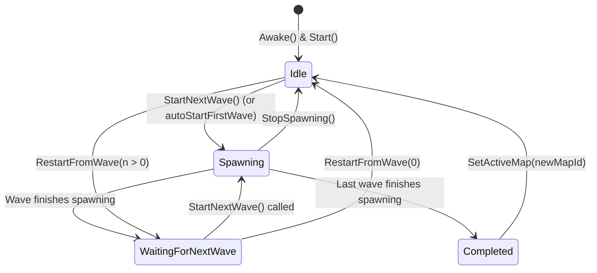
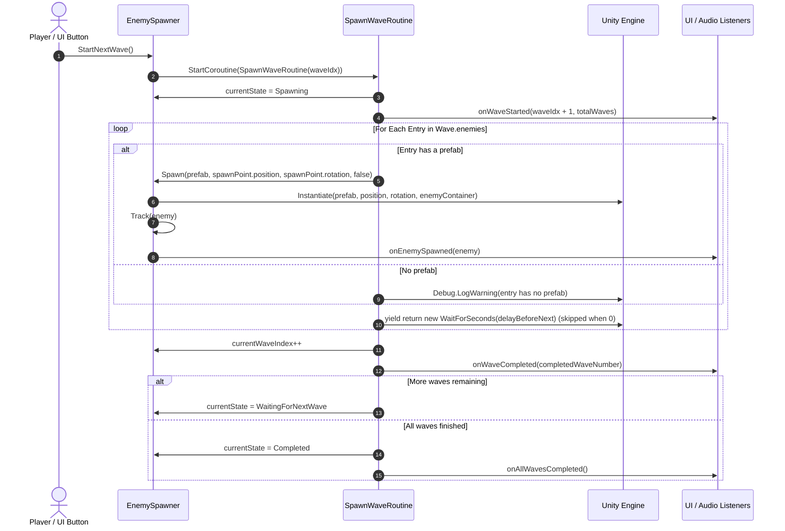

# Technical Documentation: EnemySpawner.cs

**Target Unity Version**: Unity 6 (`6000.6.0f1`)  
**Context**: 2D Tower Defense Game  
**File Location**: `Assets/_Game/Features/Enemies/Scripts/EnemySpawner/EnemySpawner.cs`  
**Companion Files**: `MapWaveDataSO.cs`, `MapWaveLookup.cs`, and beside them `Map_01.asset` and `Triangle.prefab`

---

## 1. Overview & Architecture

<!-- prose:overview -->
`EnemySpawner` is the fork's wave controller, in the namespace `HoldTheHill.Features.Enemies`. It loads the wave list for the active map, spawns each wave's enemies one at a time through a coroutine, and pauses at the end of every wave until something calls `StartNextWave()`. It keeps a list of living enemies and keeps it honest by listening to the static `EnemyHealth.Defeated` and `EnemyMover.ReachedEnd` events, so a death and a leak both leave the count. It does not decide victory, pay bounties or draw the HUD: it raises `UnityEvent`s and leaves those to listeners.

### Key Architectural Pillars
- **Map-Specific Wave Data**: the wave list comes from `MapWaveLookup.Find`, which checks the override asset, then the asset list, then the inline list, matching the map id without regard to case.
- **Sequential Coroutine Spawning**: `SpawnWaveRoutine` instantiates one entry at a time and waits `delayBeforeNext` seconds between entries, skipping the wait when the delay is zero.
- **Wave Delineation & Pausing**: after the last entry of a wave the state becomes `WaitingForNextWave` (or `Completed` after the last wave) and nothing spawns until prompted.
- **One Door Into the Run**: `Spawn(...)` and `Track(...)` are how any enemy enters, from a wave, a splitter or a cheat, so `LivingEnemyCount` and `onEnemySpawned` cover all of them.
- **Self-Correcting Living Count**: the spawner subscribes to the enemy events in `OnEnable` and unsubscribes in `OnDisable`; no death script needs a reference to it. Five public `UnityEvent` fields tell UI, audio and game flow what happened without a hard reference.
<!-- /prose -->

---

## 2. State Machine: `SpawnerState`

<!-- prose:structure -->
```csharp
public enum SpawnerState
{
    Idle,               // Waiting to start the first wave
    Spawning,           // Currently spawning enemies for the active wave
    WaitingForNextWave, // Wave spawning finished; paused until prompted to continue
    Completed           // All waves for the active map are finished
}
```



`StopSpawning()` and `RestartFromWave` work from any state; `StartNextWave()` with the index already past the last wave goes straight to `Completed` and raises `onAllWavesCompleted`.
<!-- /prose -->

---

## 3. Inspector Fields Reference

<!-- generated:fields -->
### Spawn Position
| Field | Type | Default | Description |
| :--- | :--- | :--- | :--- |
| `defaultSpawnPoint` | `Transform` | `null` | Default 2D spawn location. If null, this GameObject's transform is used (assigned in `Awake()`). |
| `enemyContainer` | `Transform` | `null` | Optional parent transform to organize spawned enemies in the Hierarchy. Passed to `Instantiate` as the parent. |

### Map Configuration
| Field | Type | Default | Description |
| :--- | :--- | :--- | :--- |
| `activeMapId` | `string` | `"Map_01"` | ID or name of the map currently active (e.g., 'Level1', 'Grasslands'). |
| `autoDetectMapFromScene` | `bool` | `false` | If true, automatically sets activeMapId to the active Scene name upon start. |
| `activeMapConfigOverride` | `MapWaveDataSO` | `null` | Direct override asset for this map's waves. If assigned, this takes top priority. |
| `scriptableMapConfigs` | `List<MapWaveDataSO>` | Empty | List of ScriptableObject wave configurations for different maps. |
| `inlineMapConfigs` | `List<MapWaveData>` | Empty | Inline wave configurations defined directly in this component's inspector. |

### Wave Progression Settings
| Field | Type | Default | Description |
| :--- | :--- | :--- | :--- |
| `autoStartFirstWave` | `bool` | `false` | If true, Wave 1 starts automatically when the scene loads. If false, waits for StartNextWave() prompt. |
| `requireEnemiesClearedBeforeNextWave` | `bool` | `false` | If true, requires all living enemies of the current wave to be defeated before StartNextWave() can be triggered. |

### Events
| Event | Signature | When Triggered | Common Use Cases |
| :--- | :--- | :--- | :--- |
| `onEnemySpawned` | `UnityEvent<GameObject>` | Invoked whenever an enemy is instantiated, from `Track`. | Minimap tracking, spawn SFX, registering with towers. |
| `onWaveStarted` | `UnityEvent<int, int>` | Invoked when a wave starts spawning. Passes (currentWaveNumber, totalWaves). | HUD wave counter, wave start horn. |
| `onWaveCompleted` | `UnityEvent<int>` | Invoked when all enemies in the current wave have finished spawning. Passes (completedWaveNumber). | Re-enabling the "Next Wave" button. |
| `onAllWavesCompleted` | `UnityEvent` | Invoked when all waves for the active map have been finished (spawning). | Victory check together with `LivingEnemyCount`. |
| `onMapChanged` | `UnityEvent<string>` | Invoked when the active map changes. Passes (mapId). | Map title HUD, music change. |
<!-- /generated -->

---

## 4. Public API & Properties

<!-- generated:api -->
### Properties (Read-Only)
| Property | Type | Description |
| :--- | :--- | :--- |
| `CurrentState` | `SpawnerState` | The current state (`Idle`, `Spawning`, `WaitingForNextWave`, `Completed`). |
| `ActiveMapId` | `string` | The id of the map whose waves are loaded. |
| `CurrentWaveIndex` | `int` | Zero-based index of the current wave (`0` for Wave 1). |
| `CurrentWaveNumber` | `int` | `currentWaveIndex + 1`, for display. |
| `TotalWaves` | `int` | Number of waves in the loaded list, 0 when nothing is loaded. |
| `LivingEnemyCount` | `int` | Number of tracked enemies that have neither died nor despawned at the end of the path. |
| `IsSpawning` | `bool` | True while `CurrentState` is `Spawning`. |

### UnityEvents
| Event | Signature | Raised when |
| :--- | :--- | :--- |
| `onEnemySpawned` | `UnityEvent<GameObject>` | `Track(enemy)` runs, which every `Spawn` overload calls. |
| `onWaveStarted` | `UnityEvent<int, int>` | `SpawnWaveRoutine` begins, before the first entry spawns. |
| `onWaveCompleted` | `UnityEvent<int>` | The last entry of a wave has spawned and its delay has elapsed. |
| `onAllWavesCompleted` | `UnityEvent` | The last wave has finished spawning, or `StartNextWave()` finds no wave left. |
| `onMapChanged` | `UnityEvent<string>` | `SetActiveMap(mapId)` has loaded the new list. |

### Public Methods

#### `GameObject Spawn(GameObject prefab)`
Puts an enemy into the run at the default spawn point (or this transform's position when none is set), with identity rotation, snapped to the start of the route. The one way to add an enemy outside a wave (hordes, specials, cheats) so the living count and `onEnemySpawned` stay right. Returns the instance.

#### `GameObject Spawn(GameObject prefab, Vector3 position, Quaternion rotation, bool snapToStart)`
Instantiates `prefab` at `position` and `rotation` under `enemyContainer`, calls `EnemyMover.SnapToStart()` when `snapToStart` is true and the instance has a mover, then calls `Track`. Returns `null` for a null prefab. Wave entries use this overload with `snapToStart` false.

#### `void Track(GameObject enemy)`
Counts an enemy made elsewhere (a splitter's halves) as living and raises `onEnemySpawned`. Ignores `null`.

#### `void NotifyEnemyDefeated(GameObject enemy)`
Drops an enemy from the living count. Subscribed to `EnemyHealth.Defeated` in `OnEnable`; also callable for anything that removes an enemy some other way. Ignores `null`.

#### `void StartNextWave()`
```csharp
[ContextMenu("Start Next Wave")]
public void StartNextWave()
```
Prompts the spawner to begin the next wave; wire it to a UI Button or call it from a game manager. It refuses, with a log, while `Spawning`, once `Completed`, when no waves are loaded, and when `requireEnemiesClearedBeforeNextWave` is on and enemies remain after a null purge. If the wave index is already past the end it sets `Completed` and raises `onAllWavesCompleted`. Otherwise it stops any lingering coroutine and starts `SpawnWaveRoutine(currentWaveIndex)`. Available from the component's context menu in Play Mode.

#### `void SetActiveMap(string mapId)`
Stops any running coroutine, sets the id, loads the waves through `MapWaveLookup`, resets the wave index to 0 and the state to `Idle`, clears the living list, then raises `onMapChanged`. A missing map leaves an empty list and logs a warning.

#### `void RestartFromWave(int waveIndex)`
Stops any spawning and moves to the given wave (0-based) without reloading the map, clamping the index to the loaded list. State becomes `Idle` for index 0 and `WaitingForNextWave` otherwise; the living list is cleared. The wave does not start until `StartNextWave()` is called.

#### `void StopSpawning()`
Immediately stops the active spawn coroutine, if any, and sets the state to `Idle`. The wave index and the living list are left as they are.
<!-- /generated -->

---

## 5. Execution Flow

<!-- prose:lifecycle -->
- **Awake**: if `defaultSpawnPoint` is empty it becomes this object's `transform`.
- **OnEnable**: subscribes `NotifyEnemyDefeated` to the static `EnemyHealth.Defeated` and `OnEnemyReachedEnd` to the static `EnemyMover.ReachedEnd`. `Defeated` removes the enemy from the living list outright. `ReachedEnd` removes it only when the enemy has no `EnemyMover` or its `DespawnsAtEnd` is true, so a `Stop` or `Loop` test enemy stays counted while a real leak leaves the count.
- **OnDisable**: unsubscribes both. A disabled spawner neither spawns nor counts.
- **Start**: with `autoDetectMapFromScene` on, `activeMapId` becomes `SceneManager.GetActiveScene().name`. Then `LoadMapConfiguration(activeMapId)` runs, and with `autoStartFirstWave` on, `StartNextWave()`.

### Wave Spawning Lifecycle (`SpawnWaveRoutine`)



The spawn point for a wave entry is `spawnPointOverride` when set, else `defaultSpawnPoint`; if both are somehow null the entry spawns at `Vector3.zero` with identity rotation. The routine clears `spawnCoroutine` when it ends. Each wave start, wave finish and map change writes a `Debug.Log` line.
<!-- /prose -->

---

## 6. Setup & Integration Guide

<!-- prose:setup -->
### Step 1: Component Attachment
1. In the gameplay scene, create an empty GameObject named `EnemySpawner`.
2. Add the `EnemySpawner` component (namespace `HoldTheHill.Features.Enemies`; there is no `AddComponentMenu` entry in the code, so search for it by name).
3. Create an empty child named `SpawnPoint`, place it on the first waypoint of the `EnemyPath`, and drag it into **Default Spawn Point**. Wave entries spawn here without snapping, so the position matters.
4. *(Optional)* Create an empty GameObject named `Enemies` and drag it into **Enemy Container**.

### Step 2: Wave Data Asset
1. In the Project window, right-click and choose **Create > Tower Defense > Map Wave Config** (the asset's default name is `NewMapWaveConfig`).
2. Set **Map Id** to the id the spawner will use (`Map_01` by default, or the scene name when **Auto Detect Map From Scene** is on). The comparison ignores case.
3. Add waves under **Waves** and entries under each wave's **Enemies**, assigning a prefab and a **Delay Before Next** per entry.
4. Drag the asset into **Active Map Config Override** for a one-map scene, or into **Scriptable Map Configs** for a shared spawner across maps. `Map_01.asset` beside the script is the existing example: one wave, one `Triangle.prefab` entry, delay 0.

### Step 3: Wiring
1. Create a UI Button and in its **On Click ()** list drag in the `EnemySpawner` object and select **EnemySpawner > StartNextWave()**.
2. In **On Wave Started** add the Button with `Button.interactable` false; in **On Wave Completed** add it again with `interactable` true.
3. Nothing needs wiring on the enemy side: `EnemyHealth` and `EnemyMover` raise the static events the spawner listens to. Only call `NotifyEnemyDefeated` yourself for an enemy removed by some other means.
4. Code that creates enemies outside a wave calls `Spawn(prefab)`, or `Track(enemy)` for an instance it already made, instead of `Instantiate` alone.
<!-- /prose -->

---

## 7. Against the Indev version

<!-- prose:changes -->
| Indev behaviour | Fork behaviour | What a caller changes |
| :--- | :--- | :--- |
| `Assets/Scripts/EnemySpawner/`, global namespace | `Assets/_Game/Features/Enemies/Scripts/EnemySpawner/`, namespace `HoldTheHill.Features.Enemies` | Add the `using`; the assembly is `HoldTheHill.Runtime`. |
| Living count only ever goes up: `NotifyEnemyDefeated` exists but nothing calls it, and leaks never leave the count. | Subscribes in `OnEnable` to `EnemyHealth.Defeated` and `EnemyMover.ReachedEnd`; a leak leaves the count when the mover despawns at the end. | Stop wiring death scripts to `NotifyEnemyDefeated`; it still exists for removals by other means. |
| Enemies made anywhere else are invisible to the count and to `onEnemySpawned`. | `Spawn(prefab)`, `Spawn(prefab, position, rotation, snapToStart)` and `Track(enemy)` are the one way in; `EnemySplitter` uses them. | Replace `Instantiate(enemyPrefab)` with `spawner.Spawn(enemyPrefab)`, or call `Track` on an instance. |
| "Wave completed" means finished spawning; `Completed` can arrive while enemies still walk. | Unchanged. | Decide victory from `CurrentState == Completed` and `LivingEnemyCount == 0`. |
| Map selection is a case-insensitive string match across three lists inside the spawner, with no edit-time check. | The same priority (override, asset list, inline list) in `MapWaveLookup.Find`, plain C# with EditMode tests; still no edit-time check. | Nothing at runtime; tests can call `MapWaveLookup.Find` without a scene. |
| No pooling: `Instantiate` and `Destroy` per enemy. | Unchanged. | Nothing. |
| Logs every wave start, finish and map change at `Debug.Log`. | Unchanged. | Nothing. |
| Spawn position is the spawn point or `Vector3.zero`; nothing puts an enemy on the route start. | `Spawn(prefab)` snaps through `EnemyMover.SnapToStart()`; wave entries still spawn at the spawn point unsnapped. | Code spawns need no placement; keep the scene spawn point on the first waypoint for waves. |
| One 413-line file: lookup, state machine and coroutine; five public `UnityEvent` fields that are null when the component is added from code. | Lookup moved to `MapWaveLookup.cs`; the spawner is 383 lines; the event fields are the same. | Nothing; tests still construct the events by hand. |
| (none) | `RestartFromWave(int waveIndex)` | New: jump to a wave without reloading the map. |

Still open after the stack: `onWaveCompleted` and `Completed` still mean "finished spawning" rather than "wave dead", so a `WaveCleared` raised when the count reaches zero is a candidate; there is no pooling; the per-wave `Debug.Log` lines ship in player builds; and no edit-time check confirms that every map id a spawner names exists.
<!-- /prose -->
