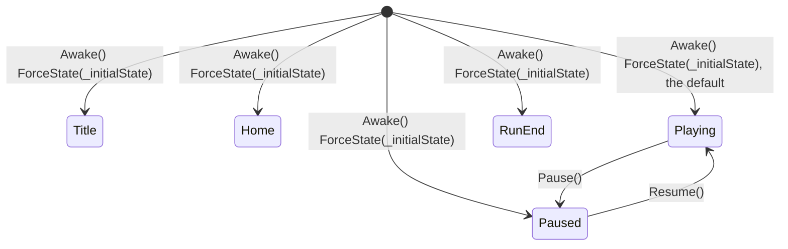

# Technical Documentation: GameFlowController.cs

**Target Unity Version**: Unity 6 (`6000.6.0f1`)  
**Context**: 2D Tower Defense Game  
**File Location**: `Assets/_Game/Features/GameFlow/Scripts/GameFlowController.cs`  
**Companion Files**: `GameFlowState.cs`, and beside them `Queen.cs` (defeat and victory); tests in `Assets/_Game/Tests/EditMode/GameFlowControllerTests.cs`

---

## 1. Overview & Architecture

<!-- prose:overview -->
`GameFlowController` is the fork's owner of game state, in the namespace `HoldTheHill.Features.GameFlow`. It holds which screen is up as a `GameFlowState`, runs time only while that state is `Playing`, and keeps the fast-forward choice. Its summary calls it "the only writer of `Time.timeScale`": everything else asks `IsPlaying` or listens to `StateChanged`. It deliberately does not know what a run is. It has no waves, no Queen, no victory or defeat, no scene loading and no menus; its remarks leave all of that to a subclass. On this branch the one subclass is the sandbox `GrayboxGameFlow`.

### Key Architectural Pillars
- **One writer of time**: every state change, speed change and override change ends in the private `ApplyTimeScale`, which sets `Time.timeScale` to the speed in `Playing` and to `0` in every other state.
- **Two public moves only**: `Pause()` goes from `Playing` to `Paused` and `Resume()` back; every other transition is the protected `Enter(next)`, called by a subclass.
- **Speed survives a pause**: `SpeedIndex` is kept while time is frozen, so `Resume()` brings back the chosen fast-forward rather than normal speed.
- **Dev override beside the player's choice**: `SetSpeedOverride` replaces the chosen speed while playing, never unfreezes a pause, and clears with `0`.
- **Plain C# event, no singleton**: `StateChanged` is an `Action<GameFlowState, GameFlowState>`, not a `UnityEvent`; listeners hold a reference to the controller. There is no static instance and no static state.
<!-- /prose -->

---

## 2. State Machine: `GameFlowState`

<!-- prose:structure -->
```csharp
/// <summary>Which screen the game is on. Time runs only in <see cref="Playing"/>.</summary>
public enum GameFlowState
{
    Title,
    Home,
    Playing,
    Paused,
    RunEnd,
}
```

The enum has no per-value comments. The diagram shows the transitions the base controller allows on its own:



`Pause()` in any state but `Playing`, and `Resume()` in any state but `Paused`, do nothing and raise nothing. The initial state is set by `ForceState`, which applies the time scale but raises no `StateChanged`. `Title`, `Home` and `RunEnd` have no way in or out in the base class: they are reached only through `Enter(next)` from a subclass. `Enter` accepts any state from any state; it raises `StateChanged` only when the state really changes, and re-applies the time scale either way.

`GrayboxGameFlow` adds these moves through `Enter`: `StartNewRun()` and `RetryWave()` go to `Playing` from any state; `QuitToHome()` goes to `Home` and `GoToTitle()` to `Title`; the Queen's `Finished` event goes to `RunEnd`, but only from `Playing`. Its `Awake` also forces `Playing` when Home loaded the scene to play it.
<!-- /prose -->

---

## 3. Inspector Fields Reference

<!-- generated:fields -->
`GameFlowController` declares no `[Header]`, `[Min]` or `[Range]`; both fields sit in one unnamed group.

| Field | Type | Default | Description |
| :--- | :--- | :--- | :--- |
| `_initialState` | `GameFlowState` | `Playing` | State on Play. Playing drops straight into the game; Title goes through the menus. |
| `_speeds` | `float[]` | `{ 1f, 2f, 4f }` | The fast-forward speeds the player can cycle through, slowest first. The first is normal speed. |

Nothing checks the speed list: an empty list makes every speed read as `1`, and nothing stops a `0` or negative entry.

The sandbox subclass adds one field of its own:

| Field | Type | Default | Description |
| :--- | :--- | :--- | :--- |
| `_autoStartDelay` (`GrayboxGameFlow`) | `float`, `[Min(0f)]` | `3` | With auto-start on, seconds between a cleared wave and the next one starting. |
<!-- /generated -->

---

## 4. Public API Reference

<!-- generated:api -->
### Properties
| Property | Type | Description |
| :--- | :--- | :--- |
| `State` | `GameFlowState` | Which screen is up. Private setter. |
| `IsPlaying` | `bool` | True while the game itself is on screen and time runs. |
| `SpeedIndex` | `int` | Index into the speed list of the fast-forward chosen. Private setter. |
| `SpeedCount` | `int` | How many speeds there are to cycle through. |
| `Speed` | `float` | The fast-forward multiplier chosen, whether or not time is running now. |
| `SpeedOverride` | `float` | A speed the dev console asked for, or 0 for none. While set it replaces the chosen speed whenever the game is playing; pause and the menus still freeze time. Private setter. |

### C# Events
| Event | Signature | Raised when |
| :--- | :--- | :--- |
| `StateChanged` | `Action<GameFlowState, GameFlowState>` | Raised after every state change with (previous, current). Not raised by `ForceState`, nor by an `Enter` into the state already held. |

### Public Methods

#### `void Pause()`
No `///` summary. Enters `Paused` when the state is `Playing`; otherwise does nothing. Time scale becomes `0`.

#### `void Resume()`
No `///` summary. Enters `Playing` when the state is `Paused`; otherwise does nothing. Time scale returns to the chosen speed, or to the override while one is set.

#### `void SetSpeedIndex(int index)`
Picks a fast-forward speed by index (clamped) and applies it if time is running. The clamp is to `0 .. _speeds.Length - 1`, and to `0` for an empty list.

#### `void CycleSpeed()`
The next speed in the list, round to the first. With the default list the speeds go 1, 2, 4, 1.

#### `float SpeedAt(int index)`
The speed at an index (clamped), or 1 if the list is empty.

#### `void SetSpeedOverride(float scale)`
Sets, or with 0 clears, the dev speed override. The flow stays the only writer of `Time.timeScale`. The value is clamped to `0 .. 20`, so a negative value also clears it.

### Protected Members (for subclasses)

#### `virtual void Enter(GameFlowState next)`
Moves to a state, applies the time scale and tells listeners if it changed.

#### `void ForceState(GameFlowState state)`
Sets the state without telling listeners. For setup before anyone listens.

#### `virtual void Awake()` and `virtual void OnDestroy()`
`Awake` calls `ForceState(_initialState)`. `OnDestroy` sets `Time.timeScale` back to `1`, because leaving Play mode paused or sped up would carry the scale into the editor. A subclass that overrides either must call the base.
<!-- /generated -->

---

## 5. Lifecycle & Execution Flow

<!-- prose:lifecycle -->
- **Awake**: `ForceState(_initialState)`. The state and the time scale are right before any other script's `Start`, and no event fires, so a listener that subscribes later should read `State` once when it subscribes.
- **OnEnable, Start, Update**: the base class has none. It does nothing per frame; time changes only when a method is called.
- **OnDestroy**: `Time.timeScale = 1f`. The graybox flow tests check this in `DestroyingTheFlow_RestoresNormalTime`.
- **Time scale rule**: `ApplyTimeScale` uses `SpeedOverride` when it is above `0`, else `Speed`, and writes it only in `Playing`; every other state writes `0`. It runs on every `Enter`, `ForceState`, `SetSpeedIndex` and `SetSpeedOverride`, so a speed picked while paused is stored and applied on `Resume()`.
- **What the EditMode tests pin down**: `Playing` runs at `1`; pause freezes time and resume brings back speed `2` after `SetSpeedIndex(1)`; `Resume()` outside `Paused` and a second `Pause()` raise nothing, so only one `(Playing, Paused)` event is seen; `CycleSpeed()` wraps from `4` to `1`; `SetSpeedIndex(99)` clamps to `2` and `-5` to `0`; an override of `10` survives pause and resume and clearing it returns to `4`; `500` clamps to `20`. The tests call `ForceState` by reflection because `Awake` does not run on `AddComponent` in edit mode.

### What the graybox adds
`GrayboxGameFlow` runs at `[DefaultExecutionOrder(-100)]`, so on the frame Escape is pressed it sees whether the tower placer still has something to cancel. Its `Update` turns the pause control into `Pause()` and `Resume()`, deferring to an open menu (`UiScreen.OpenCount`), then, only while `Playing`, counts run time, auto-starts campaign waves and checks for victory. Its `Enter` override saves progress (`GrayboxSave.SaveIfDirty`) whenever play is left. `GrayboxMenus` opens the title, home, pause and run-end screens from `StateChanged`.
<!-- /prose -->

---

## 6. Integration With Other Systems

<!-- prose:integration -->
### With `Queen.cs` (defeat and victory)
The base controller never references `Queen`. `Queen` decides both endings and raises `Finished(bool)` once: `TakeDamage` that brings health to `0` calls `TriggerDefeat`, which raises `OnGameOver`, the static `OnAnyGameOver`, the `_onGameOver` `UnityEvent` and then `Finished(false)`; `TriggerVictory` raises only `Finished(true)`. Both refuse once `IsFinished` is true. `GrayboxGameFlow` subscribes to `Finished` in `OnEnable` and, if it is `Playing`, records the run and enters `RunEnd`. On this branch nothing under `_Game` subscribes to `Finished` outside `QueenTests`, so outside the sandbox no script turns a Queen ending into `RunEnd`.

### With `EnemySpawner.cs` (what victory means)
"Wave completed" on the spawner means finished spawning. `onWaveCompleted` fires after the last entry of a wave has spawned and its delay has elapsed, and after the last wave the state becomes `Completed` and `onAllWavesCompleted` fires, while enemies may still be walking. Victory is therefore decided elsewhere. `GrayboxGameFlow.CheckForVictory` runs every `Update` while `Playing` in a campaign run, and calls `Queen.TriggerVictory()` when `CurrentState == Completed`, `LivingEnemyCount == 0` and the Queen has not finished. An endless run ends only in defeat. The same class auto-starts the next wave when the spawner is `Idle` or `WaitingForNextWave`, `LivingEnemyCount` is `0` and `_autoStartDelay` has passed, if the auto-start setting is on.

### With `TowerPlacer.cs`
`TowerPlacer` has a serialized `_flow` field ("Gates input on the game playing. Empty means always active."). Its `GameplayActive` is `_flow == null || _flow.IsPlaying`. It is the only `_Game` script that references the controller.

### With the dev tools
`DevToolsCheats` sets and clears the speed through `SetSpeedOverride`, and `GrayboxRunHotkeys` calls `CycleSpeed()` on the speed control. Neither writes `Time.timeScale` itself. `DevReplayRecorder` listens to `StateChanged`.
<!-- /prose -->

---

## 7. Setup & Integration Guide

<!-- prose:setup -->
### Step 1: Add the controller
1. In the gameplay scene, create an empty GameObject named `GameFlow`.
2. Choose **Add Component > Hold the Hill > Game Flow > Game Flow Controller**. Add only one: nothing stops a second, and both would write the time scale.
3. Leave **Initial State** on `Playing` to drop straight into the game, or set `Title` when a subclass and menus will move the state on. The base class alone can never leave `Title`, `Home` or `RunEnd`.
4. Edit **Speeds** if needed, slowest first, with normal speed as the first entry.

### Step 2: Gate input on it
1. Drag the `GameFlow` object into the **Flow** field of the `TowerPlacer`.
2. Any other script that reads input checks `IsPlaying` first. No script should write `Time.timeScale`; call `Pause()`, `Resume()`, `SetSpeedIndex()` or `SetSpeedOverride()` instead.

### Step 3: Listen in code
`StateChanged` is a C# event, so it cannot be wired in the Inspector. Subscribe in `OnEnable`, unsubscribe in `OnDisable`, and read `State` once on subscribing, because the initial state arrives without an event.

### Step 4: Decide the run
Victory and defeat need a subclass that calls `Enter(GameFlowState.RunEnd)` from `Queen.Finished`, and checks the spawner for `Completed` with zero living enemies. `GrayboxGameFlow` on `GrayboxSystems.prefab` is the working example; no scene or prefab under `_Game` uses the controller or a subclass yet.
<!-- /prose -->

---

## 8. Against the Indev version

<!-- prose:changes -->
The `Indev` branch has no flow controller and no state enum: `Features/GameFlow/` there holds only `Queen.cs`, and nothing under `unity/Assets` writes `Time.timeScale`. Its `Queen` raises `OnGameOver` and the static `OnAnyGameOver` at zero health, with no victory and no `Finished` event. There is no Indev document for game flow.

The nearest Indev code is `Core/Bootstrap/SceneLoader.cs`, in the `Bootstrap` scene. It reloads `Bootstrap` additively after the first scene loads, keeps `UI` loaded for the whole game, and opens the default level (`Hill01_Terrain`, `Hill01_Gameplay`) additively, making the last one active. A scene-level flow on Indev would sit in the always-loaded `Bootstrap` or `UI` scene, so it survives level loads. It would hook into the point where `SceneLoader` opens the level, holding back the level scenes while on `Title` or `Home`. `SceneLoader` has no public method and no event yet, so it would need a load call and a "level loaded" signal first.

| Indev | Fork | What a caller changes |
| :--- | :--- | :--- |
| (none) | `GameFlowController`, `GameFlowState` | New: one owner of screen state and time. |
| Anything may write `Time.timeScale` | Only the controller writes it | Call `Pause`, `Resume` or the speed methods instead. |
| `Queen.OnGameOver` only | `Queen.Finished(bool)` for both endings, victory through `TriggerVictory` | Listen to `Finished` to end a run. |
| `SceneLoader` loads the level at once | No scene loading in the controller | Nothing yet; the two would need joining. |
<!-- /prose -->
