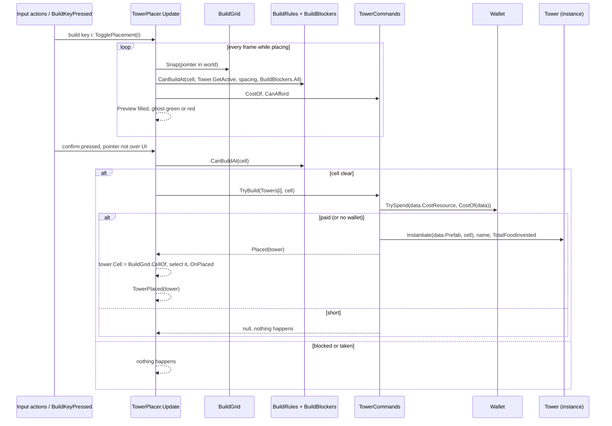

# Technical Documentation: Tower Placement (TowerPlacer, TowerCommands, BuildRules)

**Target Unity Version**: Unity 6 (`6000.6.0f1`)  
**Context**: 2D Tower Defense Game  
**File Location**: `Assets/_Game/Features/Towers/Scripts/TowerPlacer.cs` and `Assets/_Game/Features/Towers/Scripts/Placement/`  
**Companion Files**: `Placement/TowerCommands.cs`, `Placement/BuildRules.cs`, `Placement/BuildGrid.cs`, `Placement/IBuildBlocker.cs`, `Placement/BuildBlockers.cs`, `Placement/PathClearanceBlocker.cs`, `Placement/PlacementGhost.cs`, `Placement/PlacementPreview.cs`, `Placement/TowerArchetypes.cs`, and the tests `Tests/EditMode/TowerPlacerTests.cs`, `BuildRulesTests.cs`, `TowerCommandsTests.cs`

---

## 1. Overview & Architecture

<!-- prose:overview -->
Placement is one scene component and a handful of plain C# pieces. `TowerPlacer` reads the pointer and three Input System actions, keeps the interaction state (the selected tower, the open build menu, the catalog tower being placed), and draws the placement ghost; that is all it draws. Where a tower may stand is decided by `BuildRules` over the standing towers and the registered `IBuildBlocker`s. Paying, instantiating, upgrading and selling are `TowerCommands`, which the placer owns and listens to. A build bar, a build menu, a tower card and a placement label are UI that read the placer's properties and call its methods; none of that UI is in this folder.

### Key Architectural Pillars
- **Rules apart from input**: `BuildRules`, `BuildGrid` and `TowerCommands` are plain C# with EditMode tests, so the placement rule and the prices are checked without a scene.
- **Blockers register themselves**: anything that forbids building (the trail's clearance, a level's build mask) implements `IBuildBlocker` and joins the static `BuildBlockers` registry while enabled; the placer never searches the scene for them.
- **One grid, one function**: a cell is one world unit, centred on whole units (`BuildGrid.Snap` rounds), and every caller goes through `BuildGrid`.
- **Optional neighbours**: no wallet means building is free, no `GameFlowController` means input is always read, no actions assigned means no input is read, so a UI or a tool can still drive the placer by calls.
- **Swappable by subclass**: the catalog, the wallet, the play gate, the input reads and the place, upgrade and sell hooks are `protected virtual`, so a scene's own placer (the graybox one) changes those and keeps the rules.
<!-- /prose -->

---

## 2. Data flow

<!-- prose:structure -->
A placement from build key to standing tower, with the placer in placement mode:

Without placement mode, a confirm on a standing tower (within `_towerSpacing` of the click) selects it; a confirm on empty ground that no blocker forbids opens the build menu over that cell, and the menu builds through `BuildAtMenu(data)`.
<!-- /prose -->

---

## 3. Inspector Fields Reference

<!-- generated:fields -->
### TowerPlacer: Towers
| Field | Type | Default | Description |
| :--- | :--- | :--- | :--- |
| `_towers` | `List<TowerData>` | empty | The towers that can be built, in build bar order. A subclass may replace it through `Towers`. |
| `_upgradeCosts` | `int[]` | `{ 150, 300 }` | What upgrading a tower costs, by the level it is at: the first for level 1 to 2, and so on. Before discounts. |
| `_towerSpacing` | `float` | `0.8` | How close two towers may stand, in world units. Also the radius a click uses to pick a standing tower. `[Min(0)]`. |

### TowerPlacer: Scene
| Field | Type | Default | Description |
| :--- | :--- | :--- | :--- |
| `_wallet` | `WalletBehaviour` | `null` | Pays for towers. Empty means everything is free. |
| `_flow` | `GameFlowController` | `null` | Gates input on the game playing. Empty means always active. |
| `_lineMaterial` | `Material` | `null` | Material for the placement ghost's range ring. Empty draws the ring with the default line material. |

### TowerPlacer: Input
| Field | Type | Default | Description |
| :--- | :--- | :--- | :--- |
| `_point` | `InputActionReference` | `null` | The pointer position on screen (the UI map's Point). |
| `_confirm` | `InputActionReference` | `null` | Confirms a cell or picks a tower (the UI map's Click). |
| `_cancel` | `InputActionReference` | `null` | Drops the selection, build menu or placement (the UI map's Cancel). |

### PathClearanceBlocker
| Field | Type | Default | Description |
| :--- | :--- | :--- | :--- |
| `_path` | `EnemyPath` | `null` | The route to keep clear. Empty takes the `EnemyPath` on this object (`GetComponent` in `Awake`). |
| `_clearance` | `float` | `1.2` | How close to the route's centre line a tower may stand, in world units. `[Min(0)]`. |

The other placement types (`TowerCommands`, `BuildRules`, `BuildGrid`, `BuildBlockers`, `PlacementGhost`, `PlacementPreview`, `TowerArchetypes`) are plain C# and have no Inspector fields. The ghost's colours are constants: green `(0.6, 1, 0.6, 0.75)` where a tower may stand, red `(1, 0.4, 0.4, 0.65)` where it may not, a 48-segment ring 0.05 wide.
<!-- /generated -->

---

## 4. Public API Reference

<!-- generated:api -->
### Properties
| Property | Type | Description |
| :--- | :--- | :--- |
| `TowerPlacer.Commands` | `TowerCommands` | The commands this placer pays through. |
| `TowerPlacer.SelectedTower` | `Tower` | The tower whose card is open, or null. No summary in code. |
| `TowerPlacer.IsBusy` | `bool` | True while a tower is selected, the build menu is open, or a tower is being placed. |
| `TowerPlacer.ActivePlacementIndex` | `int` | Index in the catalog of the tower picked for placement, or -1. |
| `TowerPlacer.BuildMenuOpen` | `bool` | True while the build menu is open over an empty cell. |
| `TowerPlacer.BuildMenuCell` | `Vector3` | The cell the build menu is open over. |
| `TowerPlacer.Preview` | `PlacementPreview` | What the cursor would build now. `Active` is false when nothing is being placed. Refreshed only in `Update`, so it keeps its last value while the game is paused. |
| `TowerPlacer.TowerCount` | `int` | How many towers are on offer. |
| `TowerPlacer.Towers` (protected virtual) | `IReadOnlyList<TowerData>` | The towers on offer, in build bar order. The serialized list by default. |
| `TowerPlacer.WalletNow` (protected virtual) | `Wallet` | The wallet to pay from right now, or null for free. |
| `TowerPlacer.GameplayActive` (protected virtual) | `bool` | True while the game is on screen and running, so input is read. |
| `PathClearanceBlocker.Clearance` | `float` | How close to the route a tower may stand. |
| `BuildBlockers.All` (static) | `IReadOnlyList<IBuildBlocker>` | Every registered blocker, for rules that want to pass them along. |
| `PlacementPreview` fields | `Active`, `Tower`, `Cell`, `Clear`, `CanAfford`, `Cost` | A struct for a placement label: whether a catalog tower is picked and the cursor is over the field, which tower, the grid cell under the cursor, whether that cell is off the trail, not blocked and has no tower, whether it is affordable, and the cost after discounts. |

### C# Events
| Event | Signature | Raised when |
| :--- | :--- | :--- |
| `TowerPlacer.TowerPlaced` | `Action<Tower>` | After a tower is placed by the placer, including `Place` calls from tools. The tower's `Cell` is set and it is already selected. |
| `TowerPlacer.TowerUpgraded` | `Action<Tower>` | After a paid upgrade, with the tower at its new level. |
| `TowerPlacer.TowerSold` | `Action<Tower>` | Just before a tower is sold and destroyed. |
| `TowerCommands.Placed` | `Action<Tower>` | After a tower is placed, paid or not. |
| `TowerCommands.Upgraded` | `Action<Tower>` | After a paid upgrade, with the tower at its new level. |
| `TowerCommands.Sold` | `Action<Tower>` | Just before a sold tower is destroyed, before the refund is paid. |

There is no event for a failed build (blocked cell or not enough Food); a label reads `Preview.Clear` and `Preview.CanAfford` instead.

### Public Methods

#### `void TogglePlacement(int index)` (TowerPlacer)
Picks the catalog tower for placement, or puts it back if it was already picked. Picking clears the selection and closes the build menu; an index outside the catalog does nothing. Placement mode stays on after a build, so the next click builds another.

#### `void CancelInteraction()`, `void Deselect()`, `void CloseBuildMenu()` (TowerPlacer)
Drop any selection, build menu or placement in progress; close the tower card; close the build menu. The protected `ClosePlacement()` drops the build menu and placement but keeps the selection, for a catalog change.

#### `void BuildAtMenu(TowerData data)` (TowerPlacer)
Builds a tower on the cell the build menu is open over, through `TowerCommands.TryBuild`. It does not run `CanBuildAt` again; the menu only opens on a cell no blocker forbids and no tower stands within `_towerSpacing` of the click.

#### `int CostOf(TowerData data)`, `bool CanAfford(TowerData data)`, `int UpgradeCost(Tower tower)` (TowerPlacer, TowerCommands)
What a tower costs to build, after discounts; true if the wallet holds it, or there is no wallet; what upgrading this tower costs now, after discounts, 0 if it cannot be upgraded. The placer passes each straight to its `TowerCommands`.

#### `bool TryUpgradeSelected()`, `void SellSelected()` (TowerPlacer)
Pays for and applies the next level of the selected tower, false if it cannot or it costs too much; sells the selected tower for its refund and closes its card.

#### `Tower Place(TowerData data, Vector3 position, int cost)` (TowerPlacer, TowerCommands)
Places a tower from its prefab without charging for it, recording `cost` as invested, and (through the placer) selects it. No placement rule is checked; a tool or a replay is trusted.

#### `bool CanBuildAt(Vector3 position, Tower ignore = null)` (TowerPlacer)
True if a tower could stand on the cell at this position: no registered blocker forbids it and no tower other than `ignore` is within `_towerSpacing` of the cell centre. Fills its list from `Tower.GetActive` and calls `BuildRules.CanBuildAt` with `BuildBlockers.All`. The summary says "clear of the trail"; the trail is only clear when a `PathClearanceBlocker` (or another blocker covering it) is in the scene.

#### `TowerArchetype ArchetypeOf(Tower tower)`, `static Vector3 Snap(Vector3 position)` (TowerPlacer)
The role of a tower in play, for a build bar that groups by role (`TowerArchetypes.Of`: the weapon's archetype, else the catalog entry whose `DisplayName` equals the tower's name, else `Gunner`); the centre of the grid cell a world position falls in (`BuildGrid.Snap`).

#### Protected hooks (TowerPlacer)
`TryReadPointer(out Vector2)` reads `_point` when its action is enabled; `ConfirmPressed()` and `CancelPressed()` are `WasPressedThisFrame` on `_confirm` and `_cancel`; `BuildKeyPressed()` returns -1 (no build keys by default); `OnPlaced`, `OnUpgraded` and `OnSold` are empty, called before the matching public event, for a sound or an effect.

#### `Tower TryBuild(TowerData data, Vector3 position)` (TowerCommands)
Pays for a tower and places it. Null if `data` or its `Prefab` is null, or the wallet's `TrySpend(data.CostResource, cost)` fails, in which case nothing is charged. Does not check the placement rule; the caller does.

#### `bool TryUpgrade(Tower tower)`, `int Sell(Tower tower)` (TowerCommands)
Upgrade: false for a null or maxed tower or when the main resource is short; otherwise spends `UpgradeCost` from the main resource, calls `tower.Upgrade()`, adds the cost to `TotalFoodInvested` and raises `Upgraded`. Sell: raises `Sold`, earns `tower.RefundValue` into the main resource, then `Destroy` (or `DestroyImmediate` outside Play Mode) and returns the refund.

#### `TowerCommands(Func<Wallet> wallet, IReadOnlyList<int> upgradeCosts)`
`wallet` is asked each time, so it may become available after this is made; `upgradeCosts` is the cost of each upgrade by the level it is at, before discounts. A null list means no upgrade costs anything and `UpgradeCost` is 0.

#### `BuildRules` (static)
`CanBuildAt(position, towers, ignore, spacing, blockers)` snaps the position, returns false if any blocker's `Blocks(cell)` is true, then true only if `TowerAt(cell, towers, spacing, ignore)` is null. `TowerAt(point, towers, radius, ignore = null)` returns the first non-null tower other than `ignore` within `radius` (2D distance), or null.

#### `BuildGrid`, `BuildBlockers`, `IBuildBlocker` (static and interface)
`BuildGrid.Snap(position)` rounds x and y to whole units and drops z; `BuildGrid.CellOf(position)` is the same as a `Vector2Int`. `BuildBlockers.Register` adds a blocker once (a second register is ignored), `Unregister` removes it, `Blocked(cellCentre)` is true if any registered blocker forbids the cell. `IBuildBlocker.Blocks(Vector3 cellCentre)` is true if a tower cannot stand on that cell.

#### `void Show(TowerData tower, Vector3 cell, bool allowed)`, `void Hide()` (PlacementGhost)
`Show` builds the ghost on first use, sets its sprite to `tower.GhostSprite` (none draws the ring only), tints it, moves it to the cell and draws the range ring at `max(tower.Range, 0.5)`. `Hide` deactivates it. The ghost is a scene-root GameObject named `Placement Ghost`, sorting order 6, not parented to the placer.
<!-- /generated -->

---

## 5. Lifecycle & Execution Flow

<!-- prose:lifecycle -->
- **Awake** (`protected virtual`): caches `Camera.main`, creates the `TowerCommands` with `() => WalletNow` (the wallet may wake after the placer, so it is asked for each time) and `_upgradeCosts`, subscribes to its `Placed`, `Upgraded` and `Sold`, and creates the `PlacementGhost`. A subclass that overrides it must call `base.Awake()`.
- **OnEnable** (`protected virtual`): enables the three input actions if assigned. There is no `OnDisable`; the actions stay enabled when the placer is switched off.
- **Update**, in order: returns at once unless `GameplayActive`; finds `Camera.main` again if it was missing, returning if there is still none; reads the pointer and updates the ghost and `Preview` (hidden when nothing is picked, there is no pointer, or the pointer is over UI); applies a build key through `TogglePlacement`; applies cancel through `CancelInteraction`; then stops unless confirm was pressed with a pointer that is not over a UI panel (`EventSystem.IsPointerOverGameObject`; no event system counts as not over UI).
- **The click**: the screen point becomes a world point at z 0 and is snapped. In placement mode, a clear cell goes to `TryBuild` and a blocked one is ignored. Otherwise a tower within `_towerSpacing` of the unsnapped click is selected; failing that, the selection is dropped and the build menu opens over the cell if `BuildBlockers.Blocked` is false.
- **After a build**: the placer's `Placed` handler sets `tower.Cell` from `BuildGrid.CellOf`, closes the build menu, selects the new tower, calls `OnPlaced`, then raises `TowerPlaced`. `Upgraded` and `Sold` call `OnUpgraded` and `OnSold` before `TowerUpgraded` and `TowerSold`.
- **PathClearanceBlocker**: `Awake` takes the `EnemyPath` on its own object if `_path` is empty; `OnEnable` registers and `OnDisable` unregisters with `BuildBlockers`. `Blocks` is true when `EnemyPath.DistanceToRoute(cellCentre) < _clearance`; a path with fewer than two waypoints is infinitely far away and blocks nothing.
- **Static state**: the `BuildBlockers` list is cleared in a `[RuntimeInitializeOnLoadMethod(SubsystemRegistration)]` method. Standing towers come from `Tower.GetActive`, which `Tower` keeps in its own `Awake` and `OnDestroy`.
<!-- /prose -->

---

## 6. Integration With Other Systems

<!-- prose:integration -->
### With `WalletBehaviour.cs` and `Wallet.cs`
`TowerPlacer` reads `_wallet.Wallet` through `WalletNow`; `WalletBehaviour` makes the wallet on first use, so asking early is safe. `TowerCommands` builds with `TrySpend(data.CostResource, cost)` (null means the main resource), upgrades with `TrySpend(null, cost)` and refunds with `Earn(null, refund)`, so upgrades and refunds are always the main resource (Food). A failed `TrySpend` changes nothing. The wallet's `Changed` event is what a Food counter listens to; the placer raises nothing about money.

### With `TowerData.cs`
The placer reads `DisplayName` (the placed tower's name), `BaseCost` and `CostResource` (price), `Prefab` (what is instantiated), `GhostSprite` and `Range` (the ghost and its ring; `Range` is the prefab's, 0 with no prefab) and `Archetype` (for `TowerArchetypes`). `TowerData` has no size field: every tower takes one cell, and spacing is the placer's `_towerSpacing`.

### With `Tower.cs`
`TowerCommands` is the only writer of `TotalFoodInvested` and the only caller of `Upgrade()`; the placer is the only writer of `Cell`. Costs are `RoundToInt(base * UpgradeModifiers.Current.CostMultiplier)`, the refund is `Tower.RefundValue`.

### With `EnemyPath.cs`
`PathClearanceBlocker` reads `DistanceToRoute`, the distance to the route's centre line. `EnemyPath.Blocks(cellCenter, cellSize)` still exists on this branch (road width plus cell size, less 0.01) but nothing in `_Game` or `_Sandbox` calls it.

### With `GameFlowController.cs`
The placer reads `IsPlaying` each frame when `_flow` is set and reads no input otherwise.

### Input
No input script in `_Game/Core` is involved; `Core` holds `SceneLoader` and `SpriteUtil` only. The placer reads `InputActionReference`s, meant for the `UI` map's `Point`, `Click` and `Cancel` actions in `Assets/Settings/InputSystem_Actions.inputactions`, which has all three.

### Other readers in `_Game`
- `Tests/EditMode/TowerPlacerTests.cs`: toggling placement, `Place` setting the cell and selecting, free building with no wallet, selling, cancelling.
- `Tests/EditMode/BuildRulesTests.cs`: snapping, empty and taken cells, the ignored tower, blockers, the registry counting a blocker once.
- `Tests/EditMode/TowerCommandsTests.cs`: paying, a short wallet charging nothing, upgrade costs by level from the main resource, zero cost at the top level, three-quarter refunds, everything free with no wallet.

Nothing else under `_Game` references the placer, the commands or the rules.

### The graybox subclass (`_Sandbox/nilly-ctrl/Graybox/GrayboxTowerPlacer.cs`)
It overrides the hooks rather than the rules: towers from a `GrayboxTowerCatalog` (swapped by species through `SetCatalog`), the wallet from `GrayboxEconomy`, the play gate from `GrayboxGameFlow`, input from `GrayboxControls` (Esc both pauses and cancels, build keys 1 to 0), and build, upgrade and sell sounds and effects in `OnPlaced`, `OnUpgraded`, `OnSold`. Its HUD reads the base class: the build bar (`ActivePlacementIndex`, `CostOf`, `CanAfford`, `TogglePlacement`), the build menu (`BuildMenuOpen`, `BuildMenuCell`, `BuildAtMenu`), the placement label (`Preview`) and the tower card (`SelectedTower`, `UpgradeCost`, `TryUpgradeSelected`, `SellSelected`, `ArchetypeOf`). `GrayboxBuildMask` is an `IBuildBlocker` for a hand-drawn level's blocked cells.
<!-- /prose -->

---

## 7. Setup & Integration Guide

<!-- prose:setup -->
### Step 1: Add the placer
1. In the gameplay scene, create an empty GameObject named `TowerPlacer`.
2. **Add Component > Hold the Hill > Towers > Tower Placer**.
3. Fill **Towers** with `TowerData` assets in build bar order. Each needs a **Prefab** with a `Tower` component, or building it does nothing.
4. Leave **Upgrade Costs** at 150, 300 unless the design says otherwise, and **Tower Spacing** below 1 so neighbouring cells stay buildable.

### Step 2: Connect the scene
1. Drag the scene's **Wallet** object into **Wallet**; leave it empty for a test scene where building is free.
2. Drag the `GameFlowController` into **Flow** so building stops while paused or on a menu.
3. Assign a line material to **Line Material** for the range ring, or leave it empty.
4. Make sure the scene has a camera tagged **MainCamera** and an `EventSystem`, so clicks on UI panels do not reach the field.

### Step 3: Bind the input
1. Set **Point** to `UI/Point`, **Confirm** to `UI/Click` and **Cancel** to `UI/Cancel` from `InputSystem_Actions`.
2. Build keys are not read by the base component. A build bar calls `TogglePlacement(index)`, or a subclass overrides `BuildKeyPressed()`.

### Step 4: Keep towers off the trail
1. Select the `EnemyPath` object and **Add Component > Hold the Hill > Towers > Path Clearance Blocker**. Leave **Path** empty; it takes the path on the same object.
2. Set **Clearance** to how far from the route's centre line a tower must stand (1.2 by default).
3. For other no-build ground (furniture, the hill), add a component that implements `IBuildBlocker` and calls `BuildBlockers.Register(this)` in `OnEnable` and `Unregister(this)` in `OnDisable`.

No scene on this branch uses the plain `TowerPlacer` or `PathClearanceBlocker` yet; `GrayboxCombatTest` and `KitchenFloor` use the graybox subclass, with `GrayboxBuildMask` blocking the trail.
<!-- /prose -->

---

## 8. Against the Indev version

<!-- prose:changes -->
The Indev `TowerPlacer.cs` is a single-prefab mouse placer: left-click builds on a free cell, right-click removes, a translucent square previews the cell. Its `Tower.cs` is the stub that only knows its range and cell. The build rule lived on `EnemyPath.Blocks(cell, size)`, which ties the road's drawn width to how close a tower may stand and cannot be tested without a scene (`docs/ENEMY_SPAWNER_AND_PATH_NOTE.md`, EnemyPath point 4).

| Question | Indev | Fork | What a caller changes |
| :--- | :--- | :--- | :--- |
| How a cell is chosen | `Mouse.current` position, `FloorToInt(world / _cellSize)`, centred on half units; `_cellSize` in the Inspector (1) | `Point` action, `BuildGrid.Snap` rounds to whole units, one unit per cell, no size field | Cell centres move by half a unit; level art and masks follow `BuildGrid`. |
| What blocks a build | The cell is in the placer's own `Dictionary<Vector2Int, Tower>`, or `EnemyPath.Blocks(cell, _cellSize)` (road width) | `BuildRules.CanBuildAt`: any registered `IBuildBlocker` (`PathClearanceBlocker` at 1.2 from the route, a build mask), or a tower within `_towerSpacing` (0.8) | Add a `PathClearanceBlocker` to the path; other no-build ground becomes a blocker. |
| What is built | One `_towerPrefab`, or a coloured placeholder square, parented to the placer | A `TowerData` catalog; `TowerCommands.Place` instantiates `data.Prefab` at the scene root, named `DisplayName` | Make `TowerData` assets; there is no placeholder fallback. |
| Who pays | Nobody | `TowerCommands` from the wallet: build in `CostResource`, upgrades and refunds in the main resource, discounted by `CostMultiplier` | Assign a `WalletBehaviour`, or leave it empty for free building. |
| Removing a tower | Right-click destroys it, no refund | Select it, then `SellSelected()` refunds `RefundValue` | A tower card calls `SellSelected`. |
| What a HUD can listen to | Nothing; all state private | `TowerPlaced`, `TowerUpgraded`, `TowerSold`; `Preview`, `SelectedTower`, `BuildMenuOpen`, `ActivePlacementIndex`, `IsBusy` | Subscribe to the events and read the properties. |
| Preview | Square sprite, white or red, sorting order 100 | `PlacementGhost`: the tower's ghost sprite and range ring, green or red, sorting order 6; only while a catalog tower is picked | Give each `TowerData` a ghost sprite. |
| Pause and UI clicks | Always reads the mouse | Gated by `GameFlowController.IsPlaying`; clicks over UI ignored | Assign the flow and an `EventSystem`. |

What is kept: the class name, namespace, folder and script GUID (`c4bd9318…`), so a scene that holds the Indev placer keeps the component, though its old serialized fields no longer apply; `Tower.Cell`, still set by the placer on placement; `Camera.main` with `ScreenToWorldPoint`; and `EnemyPath.Blocks`, left in place with no callers.
<!-- /prose -->
