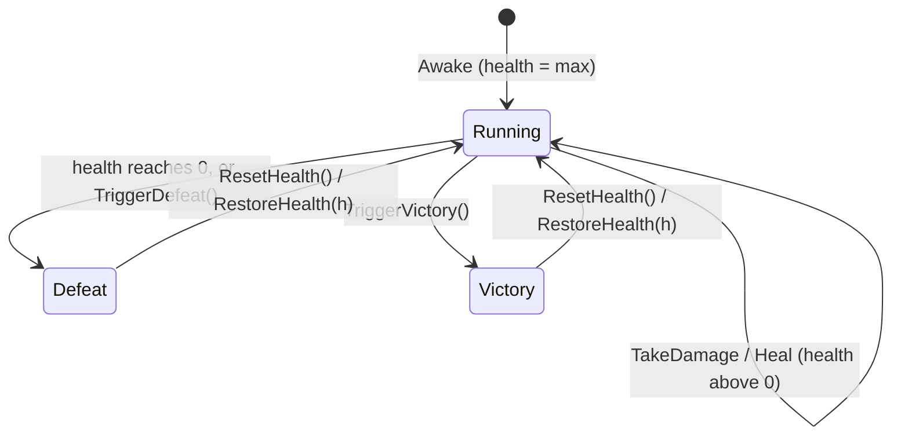

# Technical Documentation: Queen.cs

**Target Unity Version**: Unity 6 (`6000.6.0f1`)  
**Context**: 2D Tower Defense Game  
**File Location**: `Assets/_Game/Features/GameFlow/Scripts/Queen.cs`  
**Companion Files**: `Tests/EditMode/QueenTests.cs`, and from `Features/Enemies/Scripts/`: `EnemyMover.cs`, `EnemyHealth.cs`; graybox readers in `_Sandbox/nilly-ctrl/Graybox/`: `GrayboxBaseHealth.cs`, `Hud/GrayboxBaseHealthBar.cs`

---

## 1. Overview & Architecture

<!-- prose:overview -->
The Queen is the hill's heart: one health pool that enemies drain by walking in, and the place where a run ends in victory or defeat. She listens to the static `EnemyMover.ReachedEnd`, reads the breaching enemy's `EnemyHealth.BreachDamage`, and loses that much health at the enemy's position. When health reaches zero she ends the run in defeat; anyone else (the graybox flow, a dev command) can end it in victory with `TriggerVictory`. She does not change screens, stop time or count waves: `GameFlowController` owns state and `Time.timeScale` and never references the Queen; a subclass of it listens to `Finished`. She is not a singleton and has no static instance.

### Key Architectural Pillars
- **Breaches only**: an enemy whose mover stops at the hill instead of despawning (`DespawnsAtEnd` false) is skipped, so it can do its own harm; an enemy with no breach damage does nothing.
- **One end, once**: `IsFinished` latches on the first `TriggerVictory` or `TriggerDefeat`; after that, damage, heals and further triggers are ignored until `ResetHealth` or `RestoreHealth` clears it.
- **Events in two shapes**: C# events (`OnHealthChanged`, `OnGameOver`, `Finished`, `Breached`, static `OnAnyGameOver`) for code, and two `UnityEvent` fields for Inspector wiring.
- **Run-start numbers from outside**: `SetBonusHealth` raises full health above the value the scene was built with, and `RestoreHealth` puts back a saved value, so upgrades and checkpoints need no subclass.
- **Static reset**: `OnAnyGameOver` is cleared on `SubsystemRegistration`, so listeners never outlive a Play session when domain reload is off.
<!-- /prose -->

---

## 2. State Machine / Data Structures

<!-- prose:structure -->
There is no enum; the run's end is two booleans, `IsFinished` and `IsVictory`, and `IsGameOver` is `IsFinished && !IsVictory`.

In `Defeat` and `Victory`, `TakeDamage`, `Heal`, `HandleEnemyReachedEnd`, `TriggerVictory` and `TriggerDefeat` all return at once. `SetMaxHealth` and `SetBonusHealth` are not guarded and still change health in either end state.
<!-- /prose -->

---

## 3. Inspector Fields Reference

<!-- generated:fields -->
### Health Settings
| Field | Type | Default | Description |
| :--- | :--- | :--- | :--- |
| `_maxHealth` | `float` | `100` | Full health of the Queen. Permanent upgrades can raise it at the start of a run. `[Min(1)]`. |
| `_autoListenToEnemyEvents` | `bool` | `true` | If on, every enemy that walks off the end of its path damages the Queen. Off for a scene that reports breaches itself. |

### Events
| Field | Type | Default | Description |
| :--- | :--- | :--- | :--- |
| `_onGameOver` | `UnityEvent` | empty | Invoked once when the Queen's health reaches 0 (defeat). |
| `_onHealthChanged` | `UnityEvent<float, float>` | empty | Invoked whenever the Queen's health changes, with (current, max). |
<!-- /generated -->

---

## 4. Public API Reference

<!-- generated:api -->
### Properties
| Property | Type | Description |
| :--- | :--- | :--- |
| `MaxHealth` | `float` | Full health. |
| `CurrentHealth` | `float` | Health right now. Reads as `MaxHealth` before `Awake` (the backing field is `NaN` until then), so a Queen made in edit mode reads as full. Private setter. |
| `IsFinished` | `bool` | True once the run has ended either way. Private setter. |
| `IsVictory` | `bool` | True once the run has ended in victory. Private setter. |
| `IsGameOver` | `bool` | True once the run has ended in defeat. |
| `OnGameOverEvent` | `UnityEvent` | UnityEvent for game over (for Inspector wiring). |
| `OnHealthChangedEvent` | `UnityEvent<float, float>` | UnityEvent for health change (for Inspector wiring). |

### C# Events
| Event | Signature | Raised when |
| :--- | :--- | :--- |
| `OnHealthChanged` | `Action<float, float>` | This Queen's health changes, with (current, max). Also raised by `RestoreHealth`, `SetBonusHealth` and `SetMaxHealth`. Not raised in `Awake`. |
| `OnGameOver` | `Action` | Once, when this Queen's health reaches 0 (or `TriggerDefeat` is called). |
| `Finished` | `Action<bool>` | Once, when the run ends: true for victory, false for defeat. |
| `Breached` | `Action<float, Vector3>` | An enemy breaches, with the damage and where it happened. For the breach text. Raised by every accepted `TakeDamage`, before `OnHealthChanged`. |
| `OnAnyGameOver` (static) | `Action` | Any Queen's health reaches 0. Cleared on `SubsystemRegistration`. |

### Public Methods

#### `void HandleEnemyReachedEnd(GameObject enemy)`
An enemy walked off the end of its path. Takes its breach damage, unless its mover stops at the hill rather than going in, or it carries no breach damage. Ignored for a null enemy or a finished run. An object with no `EnemyMover` counts as a breach; one with no `EnemyHealth` has zero breach damage and does nothing.

#### `void TakeDamage(float amount)`
Takes damage at the Queen's own position. Calls the two-argument overload with `transform.position`.

#### `virtual void TakeDamage(float amount, Vector3 position)`
Takes damage from a breach at a position. Health stops at 0 and the defeat events fire once; nothing happens after the run has ended or for amounts of zero or less. Order: health drops, `Breached`, `OnHealthChanged` and `_onHealthChanged`, then `TriggerDefeat` at zero.

#### `virtual void Heal(float amount)`
Restores health, never above the maximum. Does nothing once the run has ended or for amounts of zero or less.

#### `void TriggerVictory()`
Ends the run in victory, once. Sets `IsFinished` and `IsVictory`, raises `Finished(true)`. Raises no game-over event.

#### `void TriggerDefeat()`
Ends the run in defeat, once. Raises `OnGameOver`, `OnAnyGameOver`, `_onGameOver`, then `Finished(false)`, in that order.

#### `virtual void ResetHealth()`
Puts health back to full and clears a finished run. Calls `RestoreHealth(MaxHealth)`.

#### `void RestoreHealth(float health)`
Puts health to a saved value (clamped to 0 and the maximum) and clears a finished run. Raises the health-change events.

#### `void SetBonusHealth(float bonus)`
Raises full health above what the scene was built with and refills it. For a permanent "tougher hill" upgrade at the start of a run; 0 puts it back. Negative bonuses count as 0, and repeated calls do not stack: each is measured from the built value recorded in `Awake`.

#### `void SetMaxHealth(float newMaxHealth, bool resetCurrentHealth = false)`
Changes full health (never below 1); current health is clamped to it, or refilled when asked. Does not move the built value `SetBonusHealth` measures from.
<!-- /generated -->

---

## 5. Lifecycle & Execution Flow

<!-- prose:lifecycle -->
- **Awake** (`protected virtual`): records `_maxHealth` as the built value for `SetBonusHealth` and sets health to full. No event is raised; a health bar should read `CurrentHealth` once on its own.
- **OnEnable** (`protected virtual`): subscribes `HandleEnemyReachedEnd` to the static `EnemyMover.ReachedEnd` when `_autoListenToEnemyEvents` is on.
- **OnDisable** (`protected virtual`): unsubscribes under the same flag. The flag is read on both sides, so changing it while enabled would leave the subscription behind.
- **No Start or Update**: everything the Queen does happens inside an event handler or a method call.
- **Subclassing**: the three lifecycle methods, `TakeDamage(float, Vector3)`, `Heal` and `ResetHealth` are virtual. A subclass that overrides `OnEnable` or `OnDisable` must call `base` or breaches stop arriving. `TriggerVictory`, `TriggerDefeat` and `HandleEnemyReachedEnd` are not virtual.
- **Static state**: `OnAnyGameOver` is set to null by a `[RuntimeInitializeOnLoadMethod(SubsystemRegistration)]` method. The instance events need no reset.
<!-- /prose -->

---

## 6. Integration With Other Systems

<!-- prose:integration -->
### With `EnemyMover.cs` and `EnemyHealth.cs`
The mover raises `Arrived` then the static `ReachedEnd(gameObject)` when an enemy with `EndBehaviour.Despawn` or `Stop` runs out of path; a `Loop` enemy raises nothing. The Queen checks `DespawnsAtEnd` on the mover and reads `BreachDamage` from `EnemyHealth` (`[Min(0)]`, default 0, set per prefab). The mover then removes a despawning enemy through `EnemyHealth.Despawn()`, which pays no bounty and raises no `Defeated`. Nothing on the enemy references the Queen.

### With the combat contracts (`IDamageable`, `IHealthReadable`)
The Queen implements neither. Towers, projectiles and hazards cannot target or hurt her, and no tower reads her health through `IHealthReadable`. The summary of `IDamageable` says the Queen "can implement it later"; on this branch she does not. Her `CurrentHealth` and `MaxHealth` match the `IHealthReadable` names but are reached by a direct `Queen` reference.

### With `GameFlowController.cs`
The base controller has no Queen reference and no defeat logic. Defeat reaches the flow through a subclass: `GrayboxGameFlow` (sandbox) finds the Queen with `FindAnyObjectByType<Queen>()`, subscribes to `Finished` in `OnEnable`, records the run and enters `GameFlowState.RunEnd`, where time stops. It calls `SetBonusHealth` at run start and `TriggerVictory` when the spawner has completed and no enemies are left.

### Graybox readers
- `GrayboxBaseHealth` (sandbox) is the graybox hill: a `Queen` subclass that shows "BREACH! -N HP" text on `Breached`, with old-name wrappers `TakeBaseDamage` and `ResetBaseHealth`. It sits on `GrayboxSystems.prefab` with `_maxHealth` 100.
- `GrayboxBaseHealthBar` (sandbox HUD) finds the Queen by type and, on each `Refresh`, draws `CurrentHealth / MaxHealth` as a bar that changes sprite at 50% and 25%. It polls; it does not subscribe to the health events.

Other sandbox code reads the Queen the same way: `GrayboxRunCheckpoint` saves `CurrentHealth` and calls `RestoreHealth`, `GrayboxNurseTower` calls `Heal`, `DevStateCommands` calls `TriggerVictory` and `TriggerDefeat`, and the god-mode cheat in `DevToolsCheats` heals on `OnHealthChanged`.
<!-- /prose -->

---

## 7. Setup & Integration Guide

<!-- prose:setup -->
### Step 1: Add the Queen
1. Create an empty GameObject at the end of the path (the hill) and add a `SpriteRenderer` if she should be seen.
2. **Add Component**, search for `Queen` (the script has no `AddComponentMenu` entry). Only one may sit on an object (`[DisallowMultipleComponent]`).
3. Set **Max Health**. Leave **Auto Listen To Enemy Events** on unless something else in the scene reports breaches by calling `HandleEnemyReachedEnd` or `TakeDamage`.

### Step 2: Make enemies breach
1. On each enemy prefab, set **Breach Damage** on `EnemyHealth` above 0; at 0 the enemy walks in harmlessly.
2. Set **On Reach End** on `EnemyMover` to `Despawn`. `Stop` raises the event but the Queen skips it; `Loop` raises nothing.

### Step 3: React to the end
1. In the Inspector, wire **On Game Over** and **On Health Changed** for simple scene reactions.
2. From code, hold a reference to the Queen and subscribe to `Finished` for both endings, or `OnHealthChanged` for a health bar. Read `CurrentHealth` once on enable, since `Awake` raises nothing.
3. Call `TriggerVictory()` when the level is won; the Queen does not detect victory herself.
<!-- /prose -->

---

## 8. Against the Indev version

<!-- prose:changes -->
The Indev `Queen.cs` has the same class name, namespace (`HoldTheHill.Features.GameFlow`), `[DisallowMultipleComponent]` and `.meta` GUID (`1d1cae56bed2419f8faccc92d892bb0d`). Jason has no Queen document under `Documentation/`; Indev has `QueenTests.cs` with seven tests.

| Indev member | Fork equivalent | What a caller changes |
| :--- | :--- | :--- |
| `double _maxHealth`, `MaxHealth`, `CurrentHealth` | `float`, with `[Min(1)]` on the field | Read `float`. |
| `Action<double, double> OnHealthChanged`, `UnityEvent<double, double> _onHealthChanged` | `Action<float, float>`, `UnityEvent<float, float>` | Change handler signatures to `float`; rewire any Inspector calls. |
| Listens to `BasicEnemy.OnAnyDestinationReached`, takes `enemy.Damage` (`int`) | Listens to `EnemyMover.ReachedEnd`, takes `EnemyHealth.BreachDamage` (`float`), skips enemies that do not despawn | Set **Breach Damage** on enemy prefabs. |
| `virtual HandleEnemyReachedDestination(BasicEnemy)` | `HandleEnemyReachedEnd(GameObject)`, not virtual | Pass the enemy's GameObject. |
| `RegisterEnemy(BasicEnemy)`, `UnregisterEnemy(BasicEnemy)` | (none) | Turn auto-listen off and call `HandleEnemyReachedEnd` yourself. |
| `virtual TakeDamage(double)` | `TakeDamage(float)` plus `virtual TakeDamage(float, Vector3)`, and the `Breached` event | Pass a `float`; pass the position for breach text. |
| `protected virtual TriggerGameOver()` | `public TriggerDefeat()`, not virtual, which also raises `Finished(false)` | Call it directly; subscribe to `Finished` instead of overriding. |
| (none) | `TriggerVictory()`, `Finished`, `IsFinished`, `IsVictory` | New: the run's end either way. |
| (none) | `RestoreHealth(float)`, `SetBonusHealth(float)` | New: checkpoints and run-start upgrades. |
| `SetMaxHealth` floors at 0 | Floors at 1 | Nothing in normal use. |
| `OnAnyGameOver` never reset | Reset on `SubsystemRegistration` | Nothing. |
| `Debug.Log` on every hit and on game over | No logging | Nothing. |

What is kept: `_maxHealth`, `_autoListenToEnemyEvents`, `_onGameOver` and `_onHealthChanged` keep their names; `OnGameOver`, `OnAnyGameOver`, `IsGameOver`, `OnGameOverEvent`, `OnHealthChangedEvent`, `Heal`, `ResetHealth` and the virtual `Awake`, `OnEnable`, `OnDisable` keep their names and roles. Because the GUID and field names match, `_Sandbox/MetalBear4-2243/Path and Queen Test.unity` resolves to this class on both branches, with `_maxHealth` 100 and no persistent calls on either UnityEvent.
<!-- /prose -->
