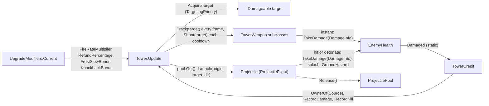

# Technical Documentation: Towers and Weapons (Tower, TowerWeapon, Projectile)

**Target Unity Version**: Unity 6 (`6000.6.0f1`)  
**Context**: 2D Tower Defense Game  
**File Location**: `Assets/_Game/Features/Towers/Scripts/` and `Assets/_Game/Features/Combat/Scripts/`  
**Companion Files**: `TargetingPriority.cs`, `TowerCredit.cs`, `TimedTowerWeapon.cs`, `ProjectileFlight.cs`, `FlightMode.cs`, `ProjectilePool.cs`, `CombatUtil.cs`, `IOwned.cs`, `TowerArchetype.cs`, and from `Features/Progression/Scripts/`: `IUpgradeModifiers.cs`, `UpgradeModifiers.cs`

---

## 1. Overview & Architecture

<!-- prose:overview -->
A placed tower is a `Tower` component plus whatever attacks sit beside it. `Tower` owns the grid cell, the range, the targeting choice and the fire cadence; it does not know how any attack works. Each attack is a `TowerWeapon` subclass on the same GameObject, or a `Projectile` prefab the tower launches from a `ProjectilePool`. Everything a weapon hits is an `IDamageable`, so nothing in these two folders references an enemy class except `TowerCredit` and `KnockbackTower`, which read `EnemyHealth` and `EnemyMover` by name. Levels and the Food spent on a tower are stored on `Tower` but changed only by `TowerCommands`.

### Key Architectural Pillars
- **A tower drives its weapons**: `Tower.Update` picks one target, hands it to every `TowerWeapon` through `Track` each frame and `Shoot` each cooldown, and fires its own projectile if it has one; the archetype base classes (`ArcTower`, `AuraTower`, `MeleeTower`, `SpawnerTower`, `SplashTower`, `SupportTower`) only name the role a weapon plays.
- **Targeting is a score**: `TargetingPriority` is resolved by `ScoreFor`, where `First` and `Last` use `EnemyPath.DistanceAlong` (the same measure as `EnemyMover.DistanceTravelled`), `Closest` uses squared distance, and `Strongest` and `Weakest` read `IHealthReadable.CurrentHealth`.
- **Credit through events**: a shot or hazard names itself as the `DamageInfo.Source` and carries an `IOwned.Owner`; `TowerCredit` listens to the static `EnemyHealth.Damaged`, resolves the owner with `CombatUtil.OwnerOf`, and calls `RecordDamage` and `RecordKill` on the tower.
- **Numbers in data, modifiers through one interface**: every damage, radius and interval is a serialized field with a tooltip, and run-wide bonuses arrive through `UpgradeModifiers.Current` (`IUpgradeModifiers`), which falls back to a neutral set when no skill tree is registered.
- **Flight maths off the scene**: `ProjectileFlight` is a plain class with no `UnityEngine.Object`, so every `FlightMode` can be flown in EditMode tests.
<!-- /prose -->

---

## 2. Data flow

<!-- prose:structure -->

A `TimedTowerWeapon` skips the `Shoot` path: it counts down in its own `Update`, scaled by `RateScale`, and calls `Trigger` whether or not the tower has a target.
<!-- /prose -->

---

## 3. Inspector Fields Reference

<!-- generated:fields -->
### Tower: Range
| Field | Type | Default | Description |
| :--- | :--- | :--- | :--- |
| `_range` | `float` | `2.5` | How far this tower can reach, in world units. |
| `_targetMask` | `LayerMask` | `~0` (everything) | Which layers count as enemies. |

### Tower: Targeting
| Field | Type | Default | Description |
| :--- | :--- | :--- | :--- |
| `_priority` | `TargetingPriority` | `First` | Which enemy to shoot when several are in range. |
| `_path` | `EnemyPath` | `null` | The path used by First and Last targeting. Found automatically if left empty. |
| `_fireInterval` | `float` | `1` | Seconds between shots. Ignored by the continuous beam. `[Min(0.05)]`. |

### Tower: Projectile (optional)
| Field | Type | Default | Description |
| :--- | :--- | :--- | :--- |
| `_projectilePrefab` | `Projectile` | `null` | Projectile fired on each shot. |
| `_muzzle` | `Transform` | `null` | Where shots leave the tower. Defaults to the tower itself. |

### Tower: Pooling
| Field | Type | Default | Description |
| :--- | :--- | :--- | :--- |
| `_projectilePool` | `ProjectilePool` | `null` | Pool that recycles this tower's projectiles. Created automatically if left empty. |

`Level` and `TotalFoodInvested` are also serialized (`[field: SerializeField, HideInInspector]`) so a tower copied with `Instantiate` by the run checkpoint keeps them; `TotalFoodInvested` carries `[FormerlySerializedAs("<TotalGoldInvested>k__BackingField")]`.

### TowerWeapon and TimedTowerWeapon
Neither base class has a serialized field. `TowerWeapon` exposes `RateScale` (set by the tower) and the virtual `Archetype`; `TimedTowerWeapon` asks its subclass for `Interval` and `Trigger`. Each concrete weapon declares its own fields; see section 5.

### Projectile: Flight
| Field | Type | Default | Description |
| :--- | :--- | :--- | :--- |
| `_flightMode` | `FlightMode` | `Linear` | How the shot travels: `Linear`, `Homing`, `Lobbed`, `Instant` or `SeekAndDestroy`. No tooltip in code. |
| `_speed` | `float` | `10` | Travel speed in world units per second. `[Min(0.01)]`. |
| `_turnRate` | `float` | `180` | Homing only: how fast it can turn, in degrees per second. Low values make it loop around. `[Min(0)]`. |
| `_lifetime` | `float` | `5` | Seconds before the shot gives up and despawns. `[Min(0.1)]`. |

### Projectile: Lobbed
| Field | Type | Default | Description |
| :--- | :--- | :--- | :--- |
| `_arcHeight` | `float` | `2` | Peak height of the arc above the straight line to the landing point. `[Min(0)]`. |

### Projectile: Seek and Destroy
| Field | Type | Default | Description |
| :--- | :--- | :--- | :--- |
| `_loiterDuration` | `float` | `1` | Seconds spent hovering before picking a target and diving. `[Min(0)]`. |
| `_diveSpeedMultiplier` | `float` | `2.5` | Speed multiplier applied during the dive. `[Min(1)]`. |
| `_loiterBobAmplitude` | `float` | `0.25` | How far the shot drifts while loitering. `[Min(0)]`. |

### Projectile: Damage
| Field | Type | Default | Description |
| :--- | :--- | :--- | :--- |
| `_damage` | `float` | `10` | Damage on a direct hit. `[Min(0)]`. No tooltip in code. |
| `_damageType` | `DamageType` | `Physical` | Which resistance applies. No tooltip in code. |
| `_splashRadius` | `float` | `0` | Radius of the damage dealt around the impact point. Zero for single-target. `[Min(0)]`. |
| `_splashDamage` | `float` | `5` | Damage dealt to everything caught in the splash. `[Min(0)]`. |
| `_status` | `StatusEffectData` | default | Status effect applied on hit. Duration 0 means none. |

### Projectile: Targeting
| Field | Type | Default | Description |
| :--- | :--- | :--- | :--- |
| `_targetMask` | `LayerMask` | `~0` (everything) | Which layers count as valid targets. The tower overwrites it on launch. |
| `_hitRadius` | `float` | `0.25` | How close the shot must get to count as a hit. `[Min(0.01)]`. |

### Projectile: Piercing
| Field | Type | Default | Description |
| :--- | :--- | :--- | :--- |
| `_isPiercing` | `bool` | `false` | If on, the shot carries on through targets instead of stopping at the first. |
| `_maxPierceHits` | `int` | `3` | How many targets it can pass through before despawning. `[Min(1)]`. |
| `_pierceHitCooldown` | `float` | `0.25` | Seconds before the same target can be hit again by this shot. `[Min(0.01)]`. |

### Projectile: On Impact
| Field | Type | Default | Description |
| :--- | :--- | :--- | :--- |
| `_groundHazardPrefab` | `GroundHazard` | `null` | Optional lingering hazard left where the shot lands. |
| `_groundHazardRadius` | `float` | `0` | Radius of the hazard left behind. Zero keeps the prefab's own radius. `[Min(0)]`. |
| `_groundHazardDuration` | `float` | `4` | Seconds the hazard lasts. `[Min(0.1)]`. |
| `_groundHazardDamagePerTick` | `float` | `2` | Damage the hazard deals per tick. `[Min(0)]`. |

`ProjectilePool` has `_prefab` (which projectile it recycles), `_prewarmCount` (16, instances created up front; `For()` uses 8) and `_maxSize` (256, above which idle extras are destroyed).
<!-- /generated -->

---

## 4. Public API Reference

<!-- generated:api -->
### Properties
| Property | Type | Description |
| :--- | :--- | :--- |
| `Tower.Range` | `float` | How far this tower can reach, in world units. Grows 18% per upgrade. |
| `Tower.Cell` | `Vector2Int` (get, set) | Which grid cell this tower occupies. `TowerPlacer` sets it on placement. |
| `Tower.Priority` | `TargetingPriority` (get, set) | Which enemy this tower prefers to shoot. |
| `Tower.CurrentTarget` | `IDamageable` | The enemy currently being shot at, or null. Refreshed every frame. |
| `Tower.ShotsFired` | `int` | Total shots or attacks launched by this tower (one per `FireAt`). |
| `Tower.TotalDamageDealt` | `float` | Total damage inflicted on enemies, as credited by `TowerCredit`. |
| `Tower.TotalKills` | `int` | Total enemy kills, as credited by `TowerCredit`. |
| `Tower.Level` | `int` | Current upgrade level, 1 to 3. Serialized, private setter. |
| `Tower.MaxLevel` | `int` | Always 3. |
| `Tower.CanUpgrade` | `bool` | True while `Level < MaxLevel`. |
| `Tower.TotalFoodInvested` | `int` (get, set) | Total Food spent to build and upgrade this tower. Default 100; `TowerCommands` sets it. |
| `Tower.RefundValue` | `int` | `TotalFoodInvested` times `UpgradeModifiers.Current.RefundPercentage`, rounded. |
| `Tower.FireInterval` | `float` | Seconds between shots as configured (shrinks 15% per upgrade, floor 0.1). |
| `Tower.EffectiveFireInterval` | `float` | `_fireInterval` divided by `FireRateMultiplier * max(0.05, FireRateScale)`, never below 0.05. |
| `Tower.FireRateScale` | `float` (get, set) | Fire-rate multiplier set by things done to this tower (a web halves it). 1 is normal. Setting it re-reads the weapons and passes it to each as `RateScale`. |
| `TowerWeapon.Archetype` | `TowerArchetype` (virtual) | The role this weapon plays; `Unspecified` unless an archetype base sets it. |
| `TowerWeapon.RateScale` | `float` (get, set) | Fire-rate multiplier handed down by the tower. 1 is normal. |
| `Projectile.Damage` | `float` (get, set) | Damage on a direct hit; the setter clamps at 0. |
| `Projectile.Owner` | `GameObject` (get, set) | Who fired this shot, usually the tower (`IOwned`). Damage still names the projectile as its source. |
| `Projectile.TargetMask` | `LayerMask` (get, set) | Which layers this shot can hit. |
| `Projectile.Mode` | `FlightMode` | How this shot travels. |

### C# Events
| Event | Signature | Raised when |
| :--- | :--- | :--- |
| `Tower.Upgraded` | `Action<int>` | After `Upgrade()` succeeds, with the new level. For visuals and sound. |
| `Projectile.Launched` (static) | `Action<Projectile>` | Any shot is launched, after it has been aimed and before it moves. A ricochet raises it again on every hop. For trails. |
| `PulseTower.Pulsed`, `MineLayerTower.MineLaid`, `ProximityMine.Detonated` | `Action`, `Action<ProximityMine>`, `Action` | A pulse reaches at least one enemy; a mine is placed; a mine is about to destroy itself. For visuals. |

### Public Methods

#### `bool Upgrade()` (Tower)
Upgrades the tower to the next level: returns false at `MaxLevel`, otherwise raises `Level`, multiplies `_range` by 1.18, multiplies `_fireInterval` by 0.85 (floor 0.1), scales the transform by 1.12, re-reads the weapons and calls `OnUpgraded(Level)` on each, then raises `Upgraded`. It does not touch Food; `TowerCommands.TryUpgrade` pays and adds the cost to `TotalFoodInvested`.

#### `void RecordDamage(float amount)` and `void RecordKill()` (Tower)
Add to `TotalDamageDealt` (amounts of zero or less are ignored) and `TotalKills`. Called by `TowerCredit`.

#### `static void GetActive(List<Tower> results)` (Tower)
Fills the list with every tower on an active object, including ones whose `Tower` component is switched off (a stunned tower still stands). Backed by a static list maintained in `Awake` and `OnDestroy`; use it instead of `FindObjectsByType`.

#### `void RefreshWeapons()` (Tower)
Finds the `TowerWeapon` components on this object again and gives each the current `FireRateScale`. Call after adding or removing a weapon at runtime.

#### `IDamageable AcquireTarget()` (Tower)
Overlaps `_range` on `_targetMask` through `CombatUtil.OverlapDamageables` and returns the candidate with the highest score for the current priority, or null. With no path, `First` and `Last` score 0 for everyone and the loop keeps the first candidate found.

#### `virtual void Shoot(IDamageable target)`, `virtual void Track(IDamageable target)`, `virtual void OnUpgraded(int level)` (TowerWeapon)
Empty by default. `Shoot` is called each time the tower's cooldown ends with a target in range; `Track` every frame with the current target or null; `OnUpgraded` after the tower reaches level 2 or 3.

#### `protected abstract float Interval`, `protected abstract void Trigger()`, `protected void ResetCooldown()` (TimedTowerWeapon)
The subclass supplies the seconds between triggers and what happens; `ResetCooldown` makes the weapon wait a full interval. The base `Update` is `protected virtual`.

#### `virtual void Launch(Vector2 origin, IDamageable target, Vector2 direction)` (Projectile)
Fires the shot from `origin`. `target` may be null for unguided modes, in which case `direction` is used. Resets pierce and hit state, starts the `ProjectileFlight`, faces the sprite, raises `Launched`, and for `FlightMode.Instant` resolves the hit and detonation at once.

#### `void SetPool(ProjectilePool pool)` (Projectile)
Tells the shot which pool to go back to. The pool calls it on create and on every `Get`.

#### Projectile protected surface for subclasses
`ApplyHit(IDamageable, Vector2)` deals damage and the status effect to one target; `Detonate(Vector2 point, IDamageable directHit)` applies splash, spawns the ground hazard and releases; `Expire()` releases on timeout; `SpawnGroundHazard`, `Release`, `FaceDirection`, `FindNearestTarget(from, radius)` (a radius of infinity searches 50 units) and `IsTargetAlive` are helpers; `Direction`, `CurrentTarget`, `ArcProgress`, `Age` and `IsReleased` are read-only state.

#### `ProjectileFlight` (plain C#)
`Launch(Settings, origin, Vector2? targetPosition, direction)` aims at the target if there is one, else along `direction` (zero points right), and for `Lobbed` computes the landing point and arc duration from `Speed`. `Advance(dt, Vector2? targetPosition)` moves one frame per mode; an expired or landed shot stays put, and `Instant` never moves. `WantsTarget(dt)` is true for `Homing` always and for `SeekAndDestroy` on the frame it commits to its dive. Read `Position`, `Facing`, `Direction`, `Age`, `ArcProgress`, `IsDiving`, `HasLanded`, `HasExpired`, `LandingPoint`.

#### `static ProjectilePool For(Projectile prefab, int prewarm = 8)`, `Projectile Get()`, `void Release(Projectile projectile)` (ProjectilePool)
`For` builds a pool under a new GameObject named `Pool [<prefab>]`, created inactive so `Awake` runs after the prefab is assigned. `Get` builds the pool lazily, logs an error and returns null with no prefab, and hands out an active instance. `Release` returns an instance, or destroys a projectile that came from somewhere else.
<!-- /generated -->

---

## 5. Weapon catalogue

<!-- generated:catalogue -->
| Script | Kind | What it does | Key fields |
| :--- | :--- | :--- | :--- |
| `ArcTower` | archetype base (`Arc`) | Hits instantly and holds on to its target or jumps between targets. Abstract, extends `TowerWeapon`. | none |
| `AuraTower` | archetype base (`Controller`) | Timed weapon that acts on everything around the tower to change how enemies move. Abstract, extends `TimedTowerWeapon`. | none |
| `MeleeTower` | archetype base (`Brawler`) | Strikes at close range whenever its tower fires. Abstract, extends `TowerWeapon`. No concrete subclass in this folder. | none |
| `SpawnerTower` | archetype base (`Summoner`) | Works through units it makes. Abstract, extends `TowerWeapon`. | none |
| `SplashTower` | archetype base (`Artillery`) | Timed area damage at a point, directly or by laying something down. Abstract, extends `TimedTowerWeapon`. | none |
| `SupportTower` | archetype base (`Support`) | Timed weapon that does no damage and helps the defence. Abstract, extends `TimedTowerWeapon`. No concrete subclass in this folder. | none |
| `PulseTower` | timed base | Extends `AuraTower`: on each `Trigger` overlaps `Radius` on `TargetMask`, raises `Pulsed`, calls `BeginPulse` then `Hit` per live enemy. Draws a gizmo in `GizmoColor`. | abstract `Radius`, `TargetMask`, `GizmoColor` |
| `ChainLightning` | instant (`ArcTower`) | On `Shoot`, strikes the target with `DamageType.Lightning` and leaps to the nearest unstruck enemy within `_jumpRange`, multiplying damage by `_damageFalloff` per link, up to `_maxTargets`; the `LineRenderer` shows the jagged path for `_arcDisplayTime`. | `_maxTargets` (4), `_jumpRange` (3), `_targetMask`, `_damage` (12), `_damageFalloff` (0.7), `_status`, `_arcDisplayTime` (0.12), `_jitter` (0.15), `_segmentsPerLink` (3) |
| `ContinuousBeam` | held beam (`ArcTower`) | On `Track`, holds a `LineRenderer` beam on the target and applies `DamageType.Fire` every `_tickInterval`; damage per second ramps from `_baseDamagePerSecond` by `_rampPerSecond` up to `_maxDamagePerSecond` and resets on a target change. Cuts out past `_range`. | `_baseDamagePerSecond` (6), `_rampPerSecond` (4), `_maxDamagePerSecond` (30), `_tickInterval` (0.1), `_damageType`, `_status`, `_range` (6), `_maxWidth` (0.25) |
| `FrostAuraTower` | aura pulse (`PulseTower`) | Each pulse deals `_damagePerPulse` as `Magic` and applies a `FrostChill` status (slow of `_slowMultiplier` minus `FrostSlowBonus`, clamped 0.15 to 0.9, plus a 20% damage tick every 0.5 s) for `_slowDuration`. Upgrade: radius x1.15, damage x1.4, slow 0.1 stronger. | `_radius` (3.5), `_pulseInterval` (1.2), `_damagePerPulse` (4), `_slowMultiplier` (0.45), `_slowDuration` (2.5), `_targetMask` |
| `KnockbackTower` | aura pulse (`PulseTower`) | Each pulse deals `_damage` as `Physical` and calls `EnemyMover.Knockback` with `_knockbackDistance * (1 + KnockbackBonus)`. Upgrade: radius x1.15, distance x1.35, damage x1.4. | `_radius` (3), `_pulseInterval` (2), `_damage` (8), `_knockbackDistance` (1.4), `_targetMask` |
| `MineLayerTower` | timed spawner (`SplashTower`) | Every `_layInterval`, instantiates `_minePrefab` at a random sampled point of the `EnemyPath` within `_range`, sets the mine's `SourceTower`, raises `MineLaid`. Upgrade: range x1.2, interval x0.75 (floor 0.8). | `_range` (4), `_layInterval` (2.8), `_minePrefab` |
| `ProximityMine` | hazard (plain `MonoBehaviour`) | Arms after `_armDelay`, then detonates when any target enters `_triggerRadius`: `_damage` as `Fire` to everything in `_splashRadius`, with `SourceTower` (or itself) as the `DamageInfo` source, then `Destroy`. Not `IOwned`; credit works because the source is the tower. | `_triggerRadius` (0.6), `_splashRadius` (1.6), `_damage` (35), `_armDelay` (0.4), `_targetMask` |
| `GroundHazard` | hazard (`IOwned`) | A lingering patch spawned by a projectile on impact: re-queries `_radius` every `_tickInterval`, deals `_damagePerTick` and applies `_status`, despawns after `_duration`. `Configure(...)` lets the projectile override the inspector values. | `_radius` (1), `_targetMask`, `_damagePerTick` (2), `_tickInterval` (0.5), `_damageType` (Fire), `_status`, `_duration` (4) |
| `OrbitingDamageField` | field (`SpawnerTower`) | Builds `_orbiterCount` wisps in `Start` and spins them around the tower every frame on a circular, elliptical or expanding path; each wisp deals `_contactDamage` to what it overlaps, once per `_hitCooldown` per enemy. Always on; ignores `Shoot` and `Track`. | `_orbiterCount` (3), `_radius` (1.5), `_angularSpeed` (120), `_path`, `_verticalRatio` (0.6), `_minRadiusRatio` (0.5), `_pulseSpeed` (0.5), `_contactDamage` (4), `_hitCooldown` (0.5), `_damageType` (Magic), `_status`, `_orbiterRadius` (0.3), `_targetMask`, `_orbiterSprite`, `_orbiterColor` |
| `Projectile` | projectile | One shot in flight; see sections 3, 4 and 6. | see section 3 |
| `ClusterProjectile` | projectile (`Projectile`) | Overrides `Detonate` to scatter `_fragmentCount` copies of `_fragmentPrefab` in a `_spreadAngle` fan, either on impact or, for a lobbed shot, at the apex of the arc (`ArcProgress >= 0.5`). | `_fragmentPrefab`, `_fragmentCount` (6), `_spreadAngle` (120), `_splitOn` (OnImpact), `_fragmentSpawnOffset` (0.2) |
| `RicochetProjectile` | projectile (`Projectile`) | Overrides `ApplyHit` and `Detonate` to bounce to the closest unstruck target within `_bounceRange` up to `_maxBounces` times, multiplying damage by `_damageFalloff` per hop and raising `Launched` on each. | `_maxBounces` (3), `_bounceRange` (3), `_damageFalloff` (0.8), `_allowRepeatTargets` (false) |
<!-- /generated -->

---

## 6. Lifecycle & Execution Flow

<!-- prose:lifecycle -->
- **Tower.Awake**: registers itself in the static list behind `GetActive`, defaults `_muzzle` to its own transform, finds an `EnemyPath` if `_path` is empty, creates a pool with `ProjectilePool.For(_projectilePrefab)` when it has a prefab but no pool, and calls `RefreshWeapons`.
- **Tower.Start**: calls `RefreshWeapons` again, for weapons added in code after the component.
- **Tower.Update**: sets `CurrentTarget = AcquireTarget()`, calls `Track(CurrentTarget)` on every weapon (so a beam switches off when the target is null), then counts `_cooldown` down. With a target and the cooldown spent it resets `_cooldown` to `EffectiveFireInterval` and calls `FireAt`: `ShotsFired++`, `Shoot(target)` on every weapon, then, if it has a prefab and a pool, `pool.Get()`, sets `TargetMask` and `Owner`, and `Launch(muzzle, target, direction)`.
- **Tower.OnDestroy**: leaves the static list. `Tower` has no `OnEnable` or `OnDisable`; a disabled `Tower` component stops targeting but a `TimedTowerWeapon` on the same object keeps its own clock.
- **Weapon cadence**: `TowerWeapon` subclasses have no cadence of their own; they act when the tower calls them. `TimedTowerWeapon.Update` subtracts `Time.deltaTime * max(0.05, RateScale)` from its cooldown and calls `Trigger` when it runs out, resetting to `Interval`; the first trigger happens on the first frame because the cooldown starts at 0. `ContinuousBeam` ticks in its own `Update` while it holds a target set through `Track`.
- **Projectile launch**: `Launch` records the target, clears `_recentHits`, starts the flight and raises the static `Launched` after aiming and before any movement. The pool's `OnGet` has already activated the object.
- **Projectile flight**: each `Update` returns at once if released. If the target is gone and `WantsTarget` says the mode needs one, it finds the nearest live target. It advances the flight, releases on `HasExpired` through `Expire`, copies `Position` and `Facing` to the transform, then branches: `Lobbed` detonates only on `HasLanded`; `Instant` does nothing more; the other modes run `CheckForHits`, an overlap of `_hitRadius` on `_targetMask`. A non-piercing shot detonates on its first valid hit; a piercing one keeps going until `_maxPierceHits`, re-hitting a target only after `_pierceHitCooldown`.
- **Hit and detonate**: `ApplyHit` stamps the target in `_recentHits`, calls `TakeDamage(new DamageInfo(_damage, gameObject, point, _damageType))` and applies `_status` when valid. `Detonate` calls `CombatUtil.ApplySplash` (skipping the direct hit), spawns the ground hazard with `Owner` carried over, then `Release`.
- **Release**: guarded by `_isReleased`, clears target and hits, and returns to the pool, or `Destroy` when there is none. The pool's `OnRelease` deactivates the object; above `_maxSize` idle instances the pool destroys extras.
- **Static state**: `Projectile.Launched` is not reset by a `RuntimeInitializeOnLoadMethod`; the project keeps domain reload on. `CombatUtil` clears its shared buffers on `SubsystemRegistration`, and `TowerCredit` re-hooks on `AfterAssembliesLoaded`.
<!-- /prose -->

---

## 7. Integration With Other Systems

<!-- prose:integration -->
### With `EnemyHealth.cs` and `EnemyMover.cs`
Towers and weapons only see `IDamageable` and `IHealthReadable`, both implemented by `EnemyHealth`. `TakeDamage` on the enemy multiplies the amount by `UpgradeModifiers.Current.DamageMultiplier` before shields and modifiers, so no weapon applies the damage bonus itself. `KnockbackTower` is the one weapon that reaches for `EnemyMover` directly, through `GetComponent` on the target's transform, to call `Knockback`. `First` and `Last` targeting use `EnemyPath.DistanceAlong(position)`, which measures the same route the mover's `DistanceTravelled` tracks.

### With `TowerCredit.cs`
`TowerCredit` subscribes to the static `EnemyHealth.Damaged` once, in `AfterAssembliesLoaded`, after the enemy layer's own reset has cleared the event. For each hit it resolves `CombatUtil.OwnerOf(info.Source)` (the `IOwned.Owner` of a projectile or hazard, otherwise the source itself), finds a `Tower` in that object's parents, and records the applied damage and, when `CurrentHealth` has reached zero, a kill. A weapon that is a component on the tower object (beam, aura, field) names itself as the source and is credited through the parent lookup; a mine names its `SourceTower`.

### With `TowerPlacer.cs` and `TowerCommands.cs`
`TowerCommands` is the only writer of `Level` and `TotalFoodInvested`: `Place` instantiates `TowerData.Prefab` and sets `TotalFoodInvested` to the cost paid; `TryUpgrade` charges `UpgradeCost(tower)` (the step cost for `tower.Level - 1`, times `CostMultiplier`), then calls `tower.Upgrade()` and adds the cost; `Sell` reads `tower.RefundValue`, earns it on the wallet and destroys the tower. `TowerPlacer` wraps those commands, sets `tower.Cell` from `BuildGrid.CellOf` on placement, keeps the selected tower, and uses `Tower.GetActive` to check spacing and to find the tower under a click. `TowerArchetypes.Of(tower, Towers)` reads the weapon's `Archetype` or the data asset.

### With the wallet
`Tower` never touches the wallet. Food flows through `TowerCommands`, which spends on place and upgrade and earns on sell; enemy bounty is paid by `WalletBehaviour` on `EnemyHealth.Defeated`, scaled by `BountyMultiplier`.

### With `UpgradeModifiers.cs`
`Tower` reads `FireRateMultiplier` (in `EffectiveFireInterval`) and `RefundPercentage` (in `RefundValue`). `FrostAuraTower` reads `FrostSlowBonus`, `KnockbackTower` reads `KnockbackBonus`, `TowerCommands` reads `CostMultiplier`. With nothing registered, `UpgradeModifiers.Current` is a neutral set: all multipliers 1, bonuses 0, refund 0.75.
<!-- /prose -->

---

## 8. Setup & Integration Guide

<!-- prose:setup -->
### Step 1: Make the projectile prefab
1. Create an empty GameObject named after the shot (for example `Arrow`), add a `SpriteRenderer` and assign the sprite with its tip pointing right (the shot rotates to face its travel direction).
2. **Add Component > Hold the Hill > Combat > Projectile** (or Cluster Projectile, Ricochet Projectile). Pick the **Flight Mode**, set **Speed**, **Lifetime**, **Damage** and **Damage Type**; set **Splash Radius** above zero for area damage; assign a **Ground Hazard Prefab** only if the shot should leave a patch behind.
3. No collider is needed on the shot; it polls `Hit Radius` against enemy colliders. Leave **Target Mask** as is; the tower overwrites it on launch.
4. Drag it into the Project window to make a prefab and delete the scene copy.

### Step 2: Make the tower object
1. Create an empty GameObject named after the tower, add a `SpriteRenderer`, and optionally a child `Muzzle` transform where shots should leave.
2. **Add Component > Hold the Hill > Towers > Tower**. Set **Range**, **Target Mask** (the enemy layer), **Priority** and **Fire Interval**. Leave **Path** empty; it is found at runtime.
3. For a projectile tower, assign the prefab from Step 1 as **Projectile Prefab** and the `Muzzle` child as **Muzzle**. Leave **Projectile Pool** empty to get a pool created on demand (8 prewarmed), or add a **Hold the Hill > Combat > Projectile Pool** object to the scene with the same prefab and point several towers at it to share one pool.

### Step 3: Add a weapon instead of, or beside, the projectile
1. Add one of **Hold the Hill > Combat > Frost Aura Tower**, **Knockback Tower**, **Mine Layer Tower** or **Orbiting Damage Field**, or add `ChainLightning` or `ContinuousBeam` (both require a `LineRenderer`, added automatically). Fill in its own fields; each has its own radius and target mask.
2. A `TimedTowerWeapon` (frost aura, knockback, mine layer) runs on its own interval and ignores the tower's **Fire Interval**; `ChainLightning` fires on the tower's cooldown; `ContinuousBeam` follows the tower's target every frame.
3. A weapon added from code after `Start` needs `tower.RefreshWeapons()`.

### Step 4: Save and register
1. Drag the tower into the Project window to make a prefab and delete the scene copy.
2. Reference the prefab from a `TowerData` asset so `TowerPlacer` and `TowerCommands` can place, upgrade and sell it, and so its cost and archetype are known.
3. Select the placed tower in Play Mode to see the cyan range circle and a red line to its current target.
<!-- /prose -->

---

## 9. Against the Indev version

<!-- prose:changes -->
The Indev `Tower.cs` is a stub: a range, a cell and a range gizmo, with the comment that targeting and shooting come later. The fork keeps that surface and grows it. There are no Indev weapon scripts to compare.

| `Tower` member (Indev) | Fork equivalent | What a caller changes |
| :--- | :--- | :--- |
| `[SerializeField] float _range = 2.5f`, `Range` | Same field, same default, now under a `Range` header beside `_targetMask`; grows on `Upgrade()` | Nothing. |
| `Vector2Int Cell { get; set; }` | Same | Nothing; `TowerPlacer` sets it. |
| `OnDrawGizmosSelected` (cyan range circle) | Same, plus a red line to `CurrentTarget` in Play Mode | Nothing. |
| (none) | `_priority`, `_path`, `_fireInterval`, `AcquireTarget()`, `Priority`, `CurrentTarget`, `TargetingPriority` enum | New: targeting. |
| (none) | `_projectilePrefab`, `_muzzle`, `_projectilePool`, `TowerWeapon` discovery, `FireAt`, `RefreshWeapons()`, `FireRateScale` | New: shooting. |
| (none) | `Level`, `MaxLevel`, `CanUpgrade`, `Upgrade()`, `Upgraded`, `TotalFoodInvested`, `RefundValue` | New: upgrades and refunds, driven by `TowerCommands`. |
| (none) | `ShotsFired`, `TotalDamageDealt`, `TotalKills`, `RecordDamage`, `RecordKill`, `TowerCredit` | New: statistics. |
| (none) | `static GetActive(List<Tower>)`, `[AddComponentMenu]` | New: replaces scene-wide searches. |

What is kept: `Tower.cs.meta` carries the same GUID (`4deb3d16e7dbe49768b8986b26822e29`) on both branches, and `_range` keeps its name and default, so any prefab or scene that referenced the Indev script, including the Indev tower card assets (`UI/TowerCardAssets/TowerCardBase.prefab`), still resolves to this class with its range intact.
<!-- /prose -->
